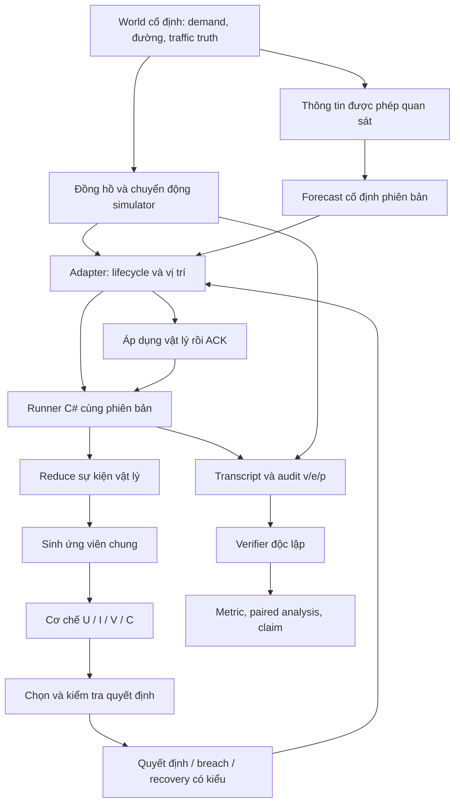
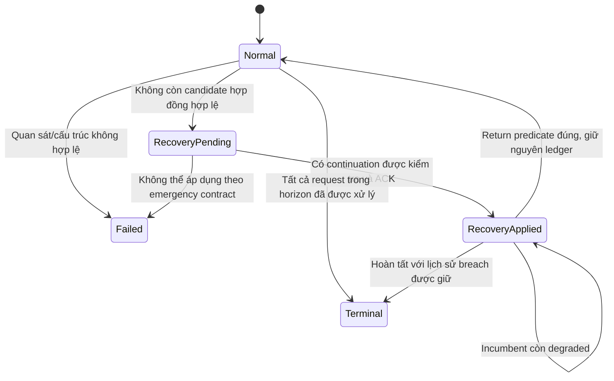

# RideBound: kế hoạch nghiên cứu và triển khai kiểm soát thay đổi lời hứa dưới giao thông ngẫu nhiên

Ngày lập: 22/09/2026. Ngôn ngữ triển khai lõi: C#/.NET. Kho nguồn được khảo sát: `E:\Code\RideBound`. Tài liệu và dữ liệu nghiên cứu nằm ngoài kho nguồn tại `E:\Code\Report_INT3508`.

> **Trạng thái: bản thảo đang được xây dựng trong quá trình đọc mã nguồn. Chưa phải bản nghiệm thu hoàn chỉnh.** Sổ đọc chính xác nằm trong `reading-progress.json`; danh mục và SHA-256 nguồn nằm trong `source-inventory.json`. Những phần chưa đọc hoặc chưa kiểm chứng sẽ không được coi là đã xác nhận. Tài liệu này là kế hoạch, không phải báo cáo về một thuật toán mới đã triển khai hoặc đã thắng thực nghiệm.

## 1. Quyết định nghiên cứu đề xuất

Hướng nên khảo sát là **tách giới hạn thay đổi do quyết định điều phối khỏi mức biến động thực tế khách nhìn thấy, rồi xác định trong điều kiện nào sự tách biệt này tạo ra một đánh đổi hữu ích và kiểm chứng được**. Đối tượng nghiên cứu là lịch sử lời hứa trong suốt một chuyến, cơ chế điều khiển lịch sử đó và độ tin cậy của lời hứa dưới nhiễu môi trường.

Không đặt mục tiêu chứng minh rằng RideBound luôn tốt hơn mọi hệ thống. Mục tiêu có thể bảo vệ trước hội đồng là: mô hình hóa chính xác một vấn đề, chỉ ra giới hạn của các cách ràng buộc khác nhau, triển khai một cơ chế có kiểm tra độc lập, và tìm được hoặc bác bỏ được một miền điều kiện mà cơ chế mang lại giá trị vận hành.

Tên làm việc của hướng nghiên cứu: **“Kiểm soát tích lũy thay đổi lời hứa và đánh giá độ tin cậy trong điều phối đi chung động dưới bất định thời gian di chuyển.”** Tên này không hàm ý đã xác lập tính mới. Tên tiếng Anh có thể dùng trong truy vấn tài liệu: *Cumulative promise-change control and reliability assessment for dynamic ride pooling under travel-time uncertainty*.

Một khóa luận mạnh cần đồng thời có câu hỏi rõ, nền so sánh công bằng, hiện thực đúng, kết quả có thể tái lập và phát biểu đóng góp vừa với bằng chứng. Không thể cam kết điểm A+ từ một ý tưởng hay từ một lượt tìm kiếm tài liệu.

### 1.1 Phạm vi tối thiểu nên hoàn thành

1. Định nghĩa và kiểm chứng ba lượng tích lũy: thay đổi do quyết định, thay đổi do cập nhật trạng thái khi giữ tuyến, và thay đổi lời hứa công bố.
2. Xây dựng môi trường nhiễu giao thông có quy tắc vật lý và thông tin rõ ràng.
3. So sánh cơ chế cùng bộ sinh ứng viên và cùng mục tiêu: không giới hạn lịch sử, giới hạn lệch so với lời hứa ban đầu, giới hạn tổng thay đổi nhìn thấy, giới hạn tổng thay đổi do quyết định.
4. Xử lý trung thực trường hợp sự kiện bên ngoài làm một giới hạn không còn khả thi; không chuyển chúng thành lỗi phần mềm hoặc biến mất khỏi mẫu đo.
5. Đo hiệu quả phục vụ, thay đổi lời hứa, sai số đến thực tế, vi phạm, chi phí và thời gian chạy; đưa ra đường đánh đổi thay vì một cấu hình thắng tùy chọn.
6. Chỉ sau khi kết quả cơ chế có ý nghĩa mới thêm hiệu chỉnh xác suất cho nhiễu tích lũy hoặc một lớp mở rộng thuật toán.

### 1.2 Những phần không nên gộp vào đóng góp bắt buộc đầu tiên

- Học tăng cường, mạng nơ-ron dự báo lớn, tái phân công xe tùy ý, tái bố trí điểm đón, tối ưu toàn thành phố.
- Cùng lúc phát triển MPA thực sự nhiều gốc, công bằng giữa nhóm, tối ưu khoảng hứa và bảo đảm conformal trực tuyến.
- Tuyên bố hài lòng người dùng khi chưa có khảo sát hoặc mô hình hành vi được kiểm định.
- Tuyên bố thuật toán tối ưu toàn cục từ nghiệm tối ưu trên tập ứng viên hữu hạn đã bị cắt.

Các phần này có thể thành nhánh sau khi cơ chế tối thiểu vượt qua các cửa kiểm chứng ở dưới. Chúng không được dùng để che việc kết quả cốt lõi còn yếu.

## 2. Bối cảnh và điều đã biết trước khi bắt đầu

### 2.1 Hiện trạng quan trọng của RideBound

RideBound đã có nhiều thành phần thích hợp cho hướng này: trạng thái miền bất biến, bộ chiếu lời hứa, ledger tích lũy, hai cơ sở tính ngân sách, bộ kiểm tra quyết định, runner có ACK và checkpoint, bộ sinh chèn yêu cầu, bộ chọn theo nhiều mức mục tiêu và cơ chế lưu bằng chứng. Vì vậy đây không phải một dự án cần viết lại từ đầu.

Tuy nhiên, có thành phần phục vụ tốt thí nghiệm hiện tại nhưng chưa đủ cho thí nghiệm nhiễu giao thông. Ví dụ, quan sát lên xe muộn ngoài cửa sổ bị mô hình miền từ chối; outcome cap có thể loại phương án giữ nguyên và làm runner lỗi; đường ghi vi phạm hiện tại chưa bao trùm mọi kiểu thất bại; dữ liệu công bố chưa chứa đủ bộ ba ETA có dấu để phân tích độc lập.

### 2.2 Những kết quả cũ không được diễn giải lại thành thành công mới

Các báo cáo nghiên cứu trước đã ghi nhận trường hợp giảm mạnh burden đi kèm giảm tỷ lệ phục vụ. Đó là một đánh đổi, chưa phải cải thiện Pareto. Các tỷ lệ khoảng −7,13 hoặc −4,9074 điểm phần trăm phục vụ và khoảng −99,83% hoặc −99,23% burden phải được trích với đúng cấu hình và mẫu của báo cáo gốc; không được gộp thành một kết quả chung cho hướng mới.

Phân tích các trạng thái bị từ chối trước đây cũng không chứng minh có sẵn một cơ hội cải thiện dễ dàng bằng thay vị trí chèn hoặc thêm chờ. Việc không tìm được sửa chữa trong một tập trạng thái và một neighborhood không phải định lý bất khả thi toàn cục. Ngược lại, một cơ hội trong trạng thái giả lập chưa phải cải thiện trong chạy đóng vòng.

Mọi kết quả số mới trong hướng này phải xuất phát từ bản chạy mới có định danh, không lấy số cũ và đổi nhãn thành “stochastic conduct”.

### 2.3 Ranh giới kho mã và quản trị thay đổi

- Không đưa cây mã BeGo/OptiGo vào RideBound.
- Domain và Application không phụ thuộc EF Core, ASP.NET, simulator, OR-Tools hoặc thực thể OptiGo.
- Adapter gọi cùng runner C# có phiên bản; không cài lại thuật toán RideBound trong Python.
- Bản kế hoạch nằm ngoài kho; chưa thay trạng thái WP14R/WP15/H7 trong tài liệu sống.
- Khi thực sự triển khai, cập nhật `docs/18-status-and-decision-log.md`, quyết định ADR tương ứng và `docs/19-requirement-traceability.md` theo thay đổi hợp đồng, claim, baseline và bước tiếp theo.
- Mỗi thay đổi mã phải chạy `dotnet test RideBound.slnx`; tích hợp BeGo còn phải giữ baseline riêng được ghi trong docs/18.
- Giữ nguyên corpus, checkout bên thứ ba, kết quả benchmark và thay đổi người dùng. Không dọn chúng như file tạm.

## 3. Câu hỏi nghiên cứu và giả thuyết có thể bị bác bỏ

### RQ1 — Các cơ chế giới hạn khác nhau thực sự kiểm soát điều gì?

So sánh giới hạn lệch từ lời hứa ban đầu, tổng biến động công bố và tổng biến động do quyết định. Xác định bằng ví dụ nhỏ, chứng minh và thử nghiệm cơ chế nào bảo vệ được đại lượng nào, và thất bại ở đâu.

**H1 đề xuất:** khi môi trường tạo cập nhật ETA đáng kể, giới hạn tích lũy theo quyết định tránh tiêu ngân sách điều phối chỉ vì giữ nguyên tuyến; tuy nhiên nó không tự giới hạn biến động khách nhìn thấy. Đây là giả thuyết về cơ chế, không phải khẳng định hiệu suất vượt trội.

### RQ2 — Đánh đổi vận hành có đáng giá không?

Với cùng dữ liệu, bộ sinh, bộ chọn, giới hạn tài nguyên và cách phục hồi, có miền nào mà conduct cap giữ được mức thay đổi do quyết định thấp trong khi phục vụ nhiều hơn outcome cap tại mức rủi ro khách hàng được chấp nhận trước không?

**H2 đề xuất:** tồn tại một miền cường độ/correlation nhiễu và ngân sách mà đánh đổi này có ý nghĩa. Nếu chỉ xuất hiện ở cấu hình cực đoan hoặc biến mất khi ghép cùng hàm mục tiêu, phải thu hẹp hoặc bác bỏ H2.

### RQ3 — Có thể phát biểu mức tin cậy cho biến động nhìn thấy không?

Đối với chính sách đã đóng băng, cadence đã cố định và phân phối episode đã nêu, một giới hạn hiệu chỉnh cho nhiễu tích lũy có tạo được bound hữu ích cho biến động công bố không?

**H3 đề xuất:** bound có thể đạt coverage mục tiêu trong phạm vi giả thiết, nhưng có thể quá rộng để hữu ích. Coverage đúng và bound hữu ích là hai yêu cầu khác nhau.

### RQ4 — Chi phí và điều kiện thất bại là gì?

Xác định độ nhạy theo cadence, độ dài chuyến, mức tải, sai số dự báo, cấu trúc nhiễu và chính sách phục hồi. Đo độ trễ quyết định, kích thước log, chi phí kiểm tra và tỷ lệ episode hoàn thành. Không bỏ những lần policy không tạo được quyết định khỏi báo cáo.

## 4. Mô hình toán học phải khóa trước khi sửa thuật toán

### 4.1 Bộ ba tham chiếu ở một epoch

Với một yêu cầu còn hoạt động và một đại lượng ETA vô hướng:

- `v_t`: ETA trong lời hứa đang có hiệu lực trước quyết định.
- `e_t`: ETA khi chiếu tuyến đang giữ trên trạng thái đã giảm sự kiện tại epoch t.
- `p_t`: ETA trong phương án được chọn để công bố ở epoch t.

Đặt `x_t = e_t − v_t`, `c_t = p_t − e_t`, `z_t = p_t − v_t`. Do đó `z_t = x_t + c_t`.

Trong code hiện tại, e được tính sau khi giảm cả batch sự kiện. Batch có thể gồm tiến xe, hủy yêu cầu, cập nhật travel time và các thay đổi trạng thái khác. Vì vậy không gọi x là “tác động nhân quả thuần túy của giao thông”. Tên phù hợp hơn là **phần thay đổi khi chiếu lại tuyến giữ nguyên trên trạng thái mới**. Chỉ trong micro-case cô lập, x mới có thể được quy hoàn toàn cho một nhiễu giao thông đã biết.

### 4.2 Đại lượng tích lũy

Với cùng lưới epoch, cùng quy tắc công bố và cùng vòng đời đo:

`C_T = Σ |c_t|`, `X_T = Σ |x_t|`, `V_T = Σ |z_t|`.

Từ bất đẳng thức tam giác, `V_T ≤ C_T + X_T`. Nếu chuỗi công bố liên tục thỏa `v_t = p_(t−1)`, V chính là total variation của ETA công bố. Đây là kiến thức toán học cơ bản, không phải đóng góp mới của khóa luận.

Lệch cuối `E_T = |p_T − p_0|` thỏa `E_T ≤ V_T`. Một giới hạn cho E hoặc cho mọi `|p_t−p_0|` không tự chặn tổng V: chuỗi có thể dao động qua lại nhiều lần trong một khoảng hẹp.

Không áp dụng nguyên xi chứng minh vô hướng này cho số lần thay đổi material, khóa điểm đón, đổi xe hay mọi thành phần trong vector 10 chiều. Mỗi đại lượng phải có ngữ nghĩa và kết luận riêng.

### 4.3 Hai phản ví dụ bắt buộc phải có trong luận văn và test

**Giữ tuyến nhưng lời hứa xấu đi:** `v=0`, `e=120`, `p=120` giây. Conduct bằng 0, visible bằng 120. Conduct cap không bảo đảm visible cap.

**Sửa để giữ lời hứa:** `v=0`, `e=120`, `p=0`. Conduct bằng 120, visible bằng 0. Conduct cap nhỏ có thể chặn một sửa chữa có lợi cho khách. Vì vậy không được mô tả conduct control như một cơ chế luôn tốt hơn outcome control.

Các giá trị 0 ở đây là mốc ETA tương đối phục vụ toán học; fixture chạy thật dùng thời điểm tuyệt đối hợp lệ trong miền.

### 4.4 Đo đổi hướng và bù trừ

Có thể báo cáo `H = V − E` để mô tả phần chuyển động qua lại trong lịch sử ETA. Với chuỗi vô hướng, H bằng hai lần phần nhỏ hơn giữa tổng tăng và tổng giảm. Nó là chỉ số mô tả, chưa phải thang hài lòng người dùng được kiểm định.

Ở từng bước, `|c_t| + |x_t| − |c_t+x_t|` đo sự bù trừ giữa quyết định và thay đổi tham chiếu. Nếu hai số trái dấu, lượng này bằng `2 min(|c_t|,|x_t|)`; cùng dấu thì bằng 0. Cần giữ riêng chỉ số bù trừ trong bước với đổi hướng trong cả lịch sử.

### 4.5 Giới hạn xác suất hai tầng

Nếu chính sách bảo đảm `C_T ≤ β` trên mọi quỹ đạo trong phạm vi nghiên cứu và có `P_π(X_T ≤ γ) ≥ 1−α`, thì `P_π(V_T ≤ β+γ) ≥ 1−α`.

Suy luận này không cần C và X độc lập. Nhưng nó cần xác định đúng phân phối dưới chính sách π, vòng đời T và cách lấy γ. Việc viết bất đẳng thức là dễ; đóng góp tiềm năng nằm ở định nghĩa đúng, hiệu chỉnh đúng và chứng minh bound còn có ích trong hệ thống thực.

Không được dùng γ lấy sau khi xem test set, γ lấy từ chính sách khác mà không kiểm định chuyển phân phối, hoặc γ theo một bước rồi gọi là bảo đảm cho cả chuyến.

### 4.6 Vòng đời, ETA và thời điểm thực tế

Tách ba loại số đo: thay đổi dự báo công bố; sai lệch thời điểm thực tế so với lời hứa ban đầu/cuối; và vi phạm cửa sổ dịch vụ. ETA ổn định có thể vẫn sai rất lớn. Một policy không cập nhật ETA không được tự động coi là bảo vệ khách tốt.

Chốt điểm bắt đầu tại initial acceptance hoặc booking confirmation theo cấu hình công khai. Chốt kết thúc riêng cho pickup và drop-off. Yêu cầu hủy, chưa được phục vụ đến hết drain, hoặc lỗi run phải có trạng thái và mẫu số rõ. Không được chỉ đo những chuyến hoàn thành dễ nhất.

## 5. Đối chiếu tài liệu và giới hạn tính mới

### 5.1 Quy tắc sử dụng nguồn

Mỗi kết luận về bài báo phải phân biệt: đã đọc toàn văn, đã đọc abstract/phần mô hình, hay mới là ứng viên cần đọc. Một kết quả tìm kiếm không thấy bài trùng không chứng minh rằng không có bài trùng. Các claim cuối cùng cần một bảng đối chiếu có trích đoạn ngắn, vị trí và giới hạn mô hình.

Không nhận là mới: dynamic insertion, giới hạn ETA, reassignment, route similarity, least commitment, time consistency, MPA, chance constraints, total variation, conformal prediction và ý tưởng đánh đổi năng suất với độ ổn định.

### 5.2 Các nguồn sát hướng nghiên cứu

| Nguồn | Phần đã có trong văn liệu | Điều RideBound cần phân biệt |
|---|---|---|
| [Schilde, Doerner, Hartl 2014](https://doi.org/10.1016/j.ejor.2014.03.005), [bản toàn văn PMC](https://pmc.ncbi.nlm.nih.gov/articles/PMC4375618/) | Dynamic DARP với thời gian di chuyển ngẫu nhiên phụ thuộc thời gian; có VNS, MPA và biến thể xét bất định | Không nhận việc thêm nhiễu giao thông hoặc ghép MPA với bất định là mới; đối chiếu đối tượng ràng buộc lịch sử lời hứa và attribution |
| [Fu 2002](https://doi.org/10.1016/S0191-2615(01)00014-5) | Lập lịch DARP trong congestion ngẫu nhiên, biến đổi theo thời gian | Xác suất đáp ứng cửa sổ khác với kiểm soát tổng thay đổi ETA do quyết định trong cả chuyến |
| [Fielbaum và Alonso-Mora 2020](https://www.sciencedirect.com/science/article/pii/S0968090X2030735X) | Nghiên cứu tính không đáng tin cậy của đi chung và biến động phục vụ | Hiện tượng khách thấy ETA thay đổi không mới; cần so sánh đúng metric và can thiệp |
| [Ackermann và Rieck 2025](https://doi.org/10.1007/s00291-025-00809-y) | Multiple plans, slack và consensus trong lập kế hoạch động | Không gọi “giữ nhiều phương án” là đóng góp mới; còn phải phân biệt B5 hiện tại với thuật toán trong bài |
| [Schulz và Pfeiffer 2026](https://link.springer.com/article/10.1007/s00291-026-00847-0) | Giờ đến đã thông báo, mức dịch chuyển cho phép và anticipation | Cần đối chiếu mốc lời hứa, mức dịch chuyển và nguồn bất định; không nhận mọi hình thức “giữ giờ đã hứa” là mới |
| [Elmi và cộng sự 2026](https://doi.org/10.1016/j.trc.2026.105897) | Cá nhân hóa và điều khiển có chọn lọc việc cập nhật | Baseline đóng băng mọi yêu cầu không phải tái lập đầy đủ bài này |
| [Tellez và cộng sự 2022](https://doi.org/10.1002/net.22063) | Tính nhất quán thời gian nhiều ngày | Không gộp khái niệm này với MPA hoặc thay đổi lời hứa trong một chuyến |
| [Dong và cộng sự 2022](https://doi.org/10.1016/j.tre.2021.102601) | Chance constraints liên quan lựa chọn/tiện ích người dùng | Không đồng nhất chance constraint bất kỳ với bảo đảm lifetime X; cũng không nhận chance constraints là mới |

Các dòng trên là định hướng đối chiếu, không phải chứng nhận “ý tưởng chưa từng tồn tại”. Bảng phải được hoàn thiện với giả thiết, hàm mục tiêu, ràng buộc và vòng đời ở bước rà soát cuối.

### 5.3 Kiến thức nên học từ bài báo nhưng không sao chép mô hình một cách máy móc

Schilde và cộng sự dùng mô hình tốc độ theo thời gian, quan hệ giữa dự báo và thông tin thực hiện, và đường đi được xác định theo giả thiết riêng. Bài này là nguồn quan trọng để học cách làm nhiễu nhất quán và kiểm soát thông tin. Không nên bê nguyên việc gắn thời gian mô phỏng với thời gian tính toán vào RideBound vì điều đó có thể làm các policy gặp những thế giới khác nhau. Cần thiết kế coupling và clock phù hợp với mục tiêu thử nghiệm của chính mình.

Về hiệu chỉnh xác suất, học thứ hạng hiệu chỉnh và phạm vi coverage từ [Angelopoulos và Bates](https://arxiv.org/abs/2107.07511). Dùng [Barber và cộng sự, Conformal prediction beyond exchangeability](https://arxiv.org/abs/2202.13415) để hiểu giới hạn khi mất exchangeability. Không viện dẫn conformal để hứa coverage phân phối tự do dưới mọi thay đổi giao thông, chính sách và hành vi khách.

### 5.4 Claim dự kiến có thể bảo vệ nếu vượt qua thực nghiệm

“Chúng tôi xây dựng và đánh giá một cơ chế kiểm soát tích lũy thay đổi lời hứa do quyết định, có tách riêng biến động khi chiếu lại tuyến giữ nguyên, chỉ ra điều kiện và chi phí khi dùng cơ chế này trong môi trường thời gian di chuyển bất định, và cung cấp bằng chứng tái lập trên cùng lõi điều phối.”

Chỉ bổ sung phần “bảo đảm xác suất hữu ích” khi giả thiết hiệu chỉnh, coverage và độ rộng đều được kiểm chứng. Nếu tìm thấy prior art trùng mô hình, phải đổi claim sang phân tích giới hạn, tái lập có kiểm chứng hoặc một khác biệt kỹ thuật thực sự; không đổi tên thuật ngữ để giữ claim.

## 6. Bản đồ triển khai đã xác minh từ lõi

Các đường dẫn trong phần này tương đối với `E:\Code\RideBound`. Số dòng và hàm cụ thể được lưu trong sổ nguồn; khi triển khai phải ghim lại commit vì dòng có thể dịch chuyển.

| Thành phần | Hiện trạng đã đọc | Việc cần làm cho hướng mới |
|---|---|---|
| Domain: CommitmentBudgetBasis, ledger, policy | Hai basis DecisionInduced/CustomerVisible, vector không âm, lịch sử tích lũy | Giữ hai đại lượng riêng; thêm cap từ initial offer như một ràng buộc riêng nếu cần |
| RideRequest.Board và Rehydrate | Quan sát actual pickup ngoài cửa sổ bị từ chối | Cho phép lưu sự thật vận hành và ghi breach, không nới cửa sổ gốc để che vi phạm |
| ITravelTimeLookup | Tra OD không có thời điểm khởi hành | MVP dùng snapshot forecast có giới hạn rõ; API phụ thuộc thời gian là nhánh riêng cần chứng minh lại cache/slack |
| PromiseProjector | e dựa reduced state; onboard pickup vẫn là lời hứa pickup trước | Tách actual arrival metrics; không diễn giải pickup ETA lưu lại là actual |
| CommitmentDecisionValidator | Tính ba delta, khóa, ngân sách và toàn bộ quyết định | Thêm cơ chế endpoint cap và chế độ kết quả vi phạm rõ ràng; tránh nhân đôi kế toán |
| InsertionCandidateGenerator | No-op được allowance cho vi phạm dịch vụ ngoại sinh; phương án thay đổi vẫn strict | Chốt quy tắc recovery và không làm baseline khác nhau chỉ vì đường sinh |
| ForwardSlackProfile | Chứng nhận đủ cho chèn thuần gây trễ dưới mô hình hiện tại | Không gọi là oracle đầy đủ; không tái dùng vô điều kiện cho travel-time phụ thuộc departure |
| CandidateSelectionModel | Bắt buộc một no-op cho mỗi xe | Tách yêu cầu có lựa chọn khả thi khỏi việc lựa chọn ấy phải là no-op; version hóa đường mới |
| HardVectorAssessor/selection | Outcome basis chỉ đổi gate; mục tiêu còn xếp decision vector | Tách factor “basis của gate” khỏi “mục tiêu”, tránh thí nghiệm lẫn nguyên nhân |
| MultiplePlanPolicy | Sinh ứng viên từ state hiện tại, lưu đa dạng/consensus; không mở rộng mọi plan cũ | Không mô tả hiện trạng là MPA nhiều gốc hoàn chỉnh |
| Wp4RunnerConfiguration | Field và variant strict, repair riêng B4, cấu hình có hash | Thêm cấu hình theo phiên bản và profile so sánh cùng khả năng |
| RunnerSession | Reduce → policy → validate → bridge → certificate → stage → ACK | Phân biệt infeasible do cơ chế với INTERNAL_ERROR; ghi được bằng chứng epoch thất bại |
| ExogenousServiceQualityBreachBridge | Ghi một loại service breach sau khi quyết định hợp lệ | Chưa phải bộ phục hồi outcome cap; cần thiết kế riêng thay vì tái sử dụng sai nghĩa |
| OnlineDecisionActionMapper | Công bố p và delta không âm | Bổ sung audit e/v/p và số có dấu với schema rõ |
| OnlineStateCanonicalizer/CheckpointCodec | Hash và phục hồi đầy đủ history/current arcs | Cập nhật mọi trường mới, kiểm tra tương thích và replay; không restore khác policy bằng cách bỏ hash |
| Contracts/DecisionMessages | Evidence yêu cầu một eligible no-op mỗi xe | Đổi đồng bộ với selector, không chỉ sửa lõi |

### 6.1 Những điểm có thể làm sai kết luận nếu bỏ qua

1. **Worst utilization với hard limit bằng 0:** hiện có nhánh đưa usage=0/limit=0 thành mức 1.000.000 ppm. Nó có thể làm mục tiêu worst utilization thành hằng số. Phải có quyết định ngữ nghĩa và ablation sửa lỗi/tương thích; không tính một sửa chữa này là đóng góp thuật toán.
2. **Cadence:** cùng timestamp có thể xuất hiện ở nhiều epoch. C/X/V phụ thuộc chuỗi cập nhật, không chỉ thời điểm đầu/cuối. Không so cadence khác nhau rồi gọi là khác biệt của budget basis.
3. **Certificate scope:** runner có thể ghi incident chất lượng dịch vụ nhưng certificate quyết định vẫn normalOperation=true theo ngữ nghĩa hiện tại. Cần xác định phạm vi chứng nhận, không suy “normal” thành “không khách nào trễ”.
4. **Hash travel snapshot:** codec kiểm tra hình thức hash và arc, chưa tự tái tính digest từ toàn bộ arc trong đường đã đọc. Adapter và harness phải có quy tắc provenance và đối chiếu thống nhất.
5. **Counterfactual fork:** checkpoint gắn manifest; đổi chính sách rồi restore không phải đường hợp lệ hiện tại. Cần harness fork có danh tính mới hoặc replay được thiết kế công khai.
6. **Giới hạn chọn:** optimal/bounds chỉ áp dụng tập ứng viên đã giữ lại. Cần báo cáo phần cắt do budget, do generator và do policy riêng nhau.

## 7. Thiết kế nghiên cứu tối thiểu trước khi mở rộng

### 7.1 Ma trận cơ chế chính

| Nhánh | Gate lịch sử | Mục tiêu dùng cho so cơ chế | Phần dùng chung |
|---|---|---|---|
| U | Không cap lịch sử nghiên cứu | Phục vụ → chi phí → tie-break | Safety, cửa sổ, generator, repair, tài nguyên |
| I | Cap lệch so initial offer | Cùng mục tiêu với U | Như trên |
| V | Cap tổng biến động visible | Cùng mục tiêu với U | Như trên |
| C | Cap tổng biến động conduct | Cùng mục tiêu với U | Như trên |

Nhánh U vẫn có các ràng buộc vật lý và dịch vụ chung. Không gọi U là tối ưu không ràng buộc. Initial-offer cap phải kiểm tra ở mọi epoch nếu câu hỏi là không rời khỏi khoảng hứa ban đầu; chỉ kiểm tra ở cuối là một baseline khác.

Sau ma trận chính mới làm factorial nhỏ đổi mục tiêu (cost-first, conduct-first, visible-first nếu cần). Phiên bản C1 lịch sử có thể xuất hiện như nhánh tái lập, nhưng không thay thế cặp so sánh chỉ khác gate.

Không yêu cầu β có cùng ý nghĩa giữa I/V/C chỉ vì đều có đơn vị giây. Báo cáo sweep và đường frontier; có thể so ở cùng mức dịch vụ hoặc cùng mức rủi ro trên validation set, rồi khóa điểm làm việc trước test.

### 7.2 Tầng thử nghiệm theo chi phí tăng dần

1. **T0: chứng minh và bảng tay.** Phản ví dụ, tam giác, reversal, đồng hồ, đầu/cuối vòng đời.
2. **T1: fixture C# nhỏ có đáp án độc lập.** Vài xe/vài yêu cầu, enumerate đầy đủ trong giới hạn công khai.
3. **T2: replay một epoch.** Kiểm tra gate/objective trên cùng state và cùng candidate set. Chỉ kết luận cục bộ.
4. **T3: synthetic đóng vòng.** Môi trường vật lý đơn giản, nhiễu có coupling, demand cố định theo seed.
5. **T4: simulator adapter.** Cùng runner, quan sát thực, không nhìn trước thông tin tương lai.
6. **T5: kiểm định giữ lại.** Episode/day chưa dùng để chọn policy hoặc ngân sách; có stress shift riêng.

Không chạy ngay một ma trận lớn trước khi T0–T3 chỉ ra cơ chế có tín hiệu. Không lấy cải thiện replay thay cho cải thiện đóng vòng.

### 7.3 Tiêu chí dừng sớm

- Dừng claim mới nếu tài liệu đã có cùng đối tượng, decomposition, cách áp ràng buộc và bằng chứng trong phạm vi tương đương; cập nhật bảng prior art trước khi tiếp tục.
- Dừng mở rộng thuật toán nếu lợi ích mất khi giữ cùng objective/generator/recovery.
- Dừng claim hữu ích của bound nếu γ quá lớn so với mức ETA biến động vận hành chấp nhận được, dù coverage đạt.
- Dừng chuyển sang dữ liệu lớn nếu không xử lý được late observations, no-op infeasibility và terminal accounting trong micro-tests.
- Nếu không có ưu thế Pareto, vẫn có thể báo cáo một đánh đổi có ý nghĩa; nếu đánh đổi không có giá trị thực tế, không cố chọn lại mẫu để giữ hướng.

## 8. Dữ liệu, traffic và cách ghép cặp thế giới thí nghiệm

### 8.1 Tách ba đối tượng thường bị gộp nhầm

1. **Mạng đường vật lý:** cạnh có chiều, chiều dài, quy tắc tốc độ; phương tiện thực sự di chuyển trên mạng này.
2. **Trạng thái giao thông thực hiện:** trường tốc độ theo cạnh và thời gian, dùng để tính chuyển động thực tế.
3. **Thông tin dự báo được phép thấy:** dữ liệu đến thời điểm hiện tại và mô hình dự báo; runner dùng thông tin này để chiếu ETA.

Trong API hiện tại, `TravelTimeSnapshot` là một tập OD. Bộ chuẩn hóa benchmark còn yêu cầu topology đầy đủ giữa các node được chọn. Không đưa một tập cạnh đường thưa vào đó rồi giả định nó có cùng nghĩa. Adapter phải chuyển mạng đường và forecast thành OD lookup đúng hợp đồng; giữ mạng vật lý ngoài Domain/Application.

MVP có thể dùng snapshot forecast tĩnh trong mỗi epoch để giữ lõi hiện tại, trong khi thế giới thực hiện thay đổi theo thời gian. Phải gọi đây là một xấp xỉ dự báo đã nêu rõ. Nếu cần departure-dependent lookup trong lõi, đó là một hạng mục riêng: API, route scheduling, cache key, forward slack và mọi oracle phải được rà lại.

### 8.2 Trường nhiễu dùng chung

Không lấy một số ngẫu nhiên mới sau mỗi lần policy hỏi OD. Hai policy có thể hỏi số lượng và thứ tự khác nhau; cách đó khiến chúng gặp những thế giới khác nhau dù cùng seed.

Đề xuất tạo trước hoặc sinh xác định theo khóa `(worldSeed, edgeId, timeBin, componentId)`. Có thể có thành phần chung toàn mạng, thành phần theo vùng và thành phần riêng cạnh, với quy tắc tương quan thời gian được khóa trước. Nhiễu dự báo dùng component riêng với nhiễu thực hiện. Không đưa armId vào khóa thế giới vật lý.

Ràng buộc bắt buộc của trường tốc độ:

- Tốc độ dương hữu hạn; quy tắc chặn được công khai.
- Độ dài cạnh không âm và thời gian qua cạnh dương cho cạnh khác node.
- Tính quãng đường đi qua các khoảng thời gian, không đổi toàn bộ thời gian chuyến theo snapshot mới một cách hồi tố.
- Kiểm tra FIFO trên cùng cạnh dưới cùng trường tốc độ; không chỉ kiểm tra travel time dương.
- Không cho xe quay ngược phần cạnh đã đi khi cập nhật ETA hoặc nhận tuyến mới.
- Query nhiều lần cùng khóa trả cùng kết quả; đổi thứ tự query không đổi kết quả.

Học cách kiểm soát FIFO từ [Ichoua, Gendreau và Potvin 2003](https://doi.org/10.1016/S0377-2217(02)00147-9) và mô hình được dùng trong Schilde 2014. Đây là nền tảng mô phỏng, không phải đóng góp mới của RideBound.

### 8.3 Mức nhiễu cần thử

Không cần bắt đầu bằng hàng trăm cấu hình. Pilot trước với: không nhiễu; nhiễu nhẹ có persistence; một đợt tắc cục bộ; shock chung toàn mạng; forecast có bias; hồi phục sau shock. Mỗi mức phải được định nghĩa bằng tham số và thể hiện bằng phân phối thời gian thực tế, không chỉ tên “low/medium/high”.

Tập kiểm định giữ lại chỉ dùng những mức đã khóa từ thiết kế. Stress test có thay đổi phân phối phải báo riêng, không gộp vào một coverage trung bình để che việc bảo đảm không áp dụng.

### 8.4 Demand và các quyết định phụ thuộc policy

Ghép cặp cùng arrivals, vị trí ban đầu, world field và simulator semantics. Không ép hai policy phải có cùng tuyến hoặc cùng thời điểm đến; đó là kết quả khác nhau cần đo. Cùng world field không có nghĩa mọi chuyến giữa hai policy gặp cùng realized travel duration, vì thời điểm và vị trí di chuyển khác nhau.

Nếu có hành vi từ chối offer hoặc hủy phụ thuộc ETA, cần mô hình hóa potential randomness dùng chung và giải thích vì sao arrivals/lifecycle có thể tách ra. MVP nên giữ demand ngoại sinh và quy tắc booking cố định; chưa ghép thêm lựa chọn hành vi khách nếu nó làm mất khả năng quy nguyên nhân.

### 8.5 Tận dụng đúng dữ liệu Manhattan đã có

`DatasetSourceRegistry` đã ghim FleetPy Manhattan v1 bằng kích thước, MD5, SHA-256 và license; downloader/extractor dùng cache bên ngoài kho. Tái sử dụng dữ liệu đã xác minh.

`FleetPyManhattanNormalizer` hiện chọn một node pool theo độ bao phủ, rồi xếp hạng yêu cầu bằng HMAC trong pool đó. Nó không phải mẫu ngẫu nhiên đại diện cho toàn Manhattan. Giới hạn hiện tại là 128 yêu cầu, 32 xe và 96 node; travel factor lấy tại một thời điểm và sinh một snapshot. Các giới hạn này phục vụ derivative cơ học và phải được ghi trong phạm vi suy rộng.

Khi mở rộng nghiên cứu, không chỉ tăng con số cap. Phải có phiên bản normalizer/selection mới, báo rõ thiên lệch do chọn node pool, giữ bảng eligible/selected/excluded và tránh chọn khu vực theo kết quả policy.

## 9. Thiết kế hiệu chỉnh xác suất theo episode

### 9.1 Đơn vị độc lập và đối tượng bảo đảm

Một episode gồm toàn bộ demand, fleet, world traffic và diễn biến của policy trong cửa sổ đã khóa, có drain đủ hoặc quy tắc censor rõ. Nhiều khách trong cùng episode cùng chịu một trường giao thông; không đếm họ thành hàng nghìn mẫu độc lập chỉ để làm confidence interval nhỏ.

MVP hiệu chỉnh một score cho mỗi episode. Ví dụ `S_j = max_r X_(r,j)` trên các yêu cầu thuộc cohort nhận lời hứa đã định nghĩa. Với pickup và drop-off, chọn trước một trong hai cách:

- Một score lấy max của cả hai đại lượng cùng đơn vị giây; đơn giản nhưng có thể rộng.
- Hai score và hai mức α được chia trước; dùng union bound cho phát biểu đồng thời.

Có thể chuẩn hóa theo độ dài chuyến nếu có lý do, nhưng scale phải xác định từ thông tin cho phép trước outcome hoặc từ tập training. Không chọn scale sau khi nhìn những chuyến vi phạm.

### 9.2 Phân chia dữ liệu

Tách bốn vai trò:

1. **Development:** sửa code, fixture, tìm lỗi và đánh giá cơ chế.
2. **Selection/validation:** chọn policy, ngân sách β, hyperparameter và score.
3. **Calibration:** chỉ tính threshold cho policy đã khóa.
4. **Test:** kiểm tra coverage, độ rộng và hiệu quả cuối cùng.

Nếu thiếu dữ liệu, có thể dùng quy trình cross-validation nghiên cứu có thiết kế riêng, nhưng không tự gọi một phép chia khách ngẫu nhiên trong cùng ngày là tập độc lập. Thí nghiệm synthetic có thể tạo episode độc lập theo seed; dữ liệu lịch sử cần xử lý phụ thuộc giữa ngày và cùng điều kiện nguồn.

### 9.3 Thuật toán threshold chính xác

Với n score calibration, lấy `k = ceil((n+1)*(1−α))`. Nếu `k ≤ n`, đặt γ bằng phần tử thứ k sau khi sắp tăng, đánh số từ 1. Nếu `k > n`, γ bằng vô cùng và ghi rõ bound không hữu hạn.

Đây là quy tắc thứ hạng conformal chuẩn; xem Appendix D, trang 50–51 của [Angelopoulos–Bates, arXiv v6](https://arxiv.org/pdf/2107.07511). Bản local đã tải có 51 trang, đề ngày 08/12/2022. Cài theo thứ hạng nguyên và xử lý ties một cách bảo thủ, không phụ thuộc mặc định interpolation của thư viện quantile.

Nếu α=0,05 thì n ít hơn 19 không cho threshold hữu hạn theo quy tắc này. Có threshold hữu hạn ở n=19 không có nghĩa hiệu chỉnh đã ổn định hay đủ để bảo vệ một kết luận thực nghiệm mạnh.

### 9.4 Suy luận áp dụng cho RideBound

Với π, generator, forecast, cadence, recovery và cohort đều đã khóa, mỗi episode calibration và episode test là một đơn vị trao đổi được. Khi score là max X trong episode, sự kiện `S_test ≤ γ` kéo theo mọi X được bao trong score của episode test đều không vượt γ. Kết hợp conduct cap được kiểm tra trên từng quỹ đạo cho bound V tương ứng.

Đây là phép áp dụng và suy luận thiết kế của kế hoạch này, không phải khẳng định rằng bài conformal đã nghiên cứu RideBound. Nó không bảo đảm đồng thời cho mọi episode trong tương lai vô hạn. Nó cũng không chứng minh conditional coverage cho từng khách, từng vùng hoặc từng mức tải.

Một episode không nhận khách có thể có score 0 theo quy ước, nhưng phải báo riêng tỷ lệ episode như vậy và tỷ lệ phục vụ. Nếu policy đạt coverage bằng từ chối gần hết khách thì không đạt tiêu chí hữu ích.

### 9.5 Incomplete lifetime, recovery và scope của định lý

Nếu chưa đo hết vòng đời, không gọi X quan sát được đến drain là X lifetime. Các lựa chọn hợp lệ gồm: kéo drain đến hoàn tất với cap tài nguyên; định nghĩa rõ finite-horizon target; hoặc coi score chưa quan sát hết là vô cùng trong một phép hiệu chỉnh bảo thủ. Phải chọn trước một cách, không thay theo kết quả.

Nếu recovery cho phép vượt conduct cap thì điều kiện `C≤β` không còn đúng trên các quỹ đạo ấy. Có hai cách trung thực: giữ conduct cap cả trong recovery và ghi physical infeasibility riêng; hoặc phát biểu bound có thêm accounting phần recovery, với định lý và metric mới. Không loại episode recovery sau outcome rồi giữ nguyên claim xác suất ban đầu.

### 9.6 Kiểm định và điều kiện không đạt

- Báo empirical episode coverage với mẫu số episode, số vi phạm và khoảng bất định phù hợp.
- Báo phân phối γ/β và tỷ lệ bound vượt mức thay đổi khách hàng đã xác định là hữu ích.
- Báo cohort khách được nhận, khách hoàn tất và chuyến dài; không chỉ average toàn bộ.
- Kiểm tra triển khai trên score độc lập có phân phối biết trước, gồm ties, n nhỏ, k=n, k=n+1 và integer overflow.
- Kiểm tra shift riêng: tăng persistence, shock, bias, tải. Khi giả thiết exchangeability bị phá, gọi đây là stress test ngoài bảo đảm.
- Không bê quy tắc “khoảng 1.000 mẫu là đủ” từ một hướng dẫn tổng quát; chọn số episode dựa trên độ chính xác mong muốn, chi phí và pilot đã công khai.

## 10. Hợp đồng chỉ số và oracle cần xây dựng

### 10.1 Các giới hạn của bộ tính hiện tại đã xác minh

`DecisionInducedBurdenCalculator` kiểm tra lifecycle rất chặt nhưng contract WP8 không cho cancellations và yêu cầu mọi acceptance có booking, boarding và completion. Nó không trực tiếp phù hợp với run bị gián đoạn, drain chưa xong hoặc cancellation dưới nhiễu.

`MechanicalMetricCalculator` chỉ xuất outcome metrics cho run succeeded. `request.completion.ppm` ở đây là completed/accepted, còn mô hình paired WP8 có shared denominator là arrivals. Hai tỷ lệ đều có ích nhưng không được dùng cùng tên trong bảng kết quả mà bỏ mẫu số.

`commitment.breach.count` của bộ tính cơ học đếm action `commitmentBreachDeclared`; nó không tự đọc incident ledger trong checkpoint. Vì runner bridge hiện không ánh xạ mọi incident thành action đó, con số 0 không đủ để chứng minh không có vi phạm dịch vụ ngoại sinh.

`decisionDelta.*.max` là maximum trên các publication delta, không phải maximum tổng tích lũy theo khách. Bộ registry cơ học còn ghim đúng 36 định nghĩa và hash bất biến. Phải tạo registry nghiên cứu theo phiên bản, không sửa nghĩa metric cũ trong khi giữ ID.

### 10.2 Bộ chỉ số tối thiểu

| Nhóm | Chỉ số | Mẫu số/phạm vi cần ghi |
|---|---|---|
| Phục vụ | Accepted/arrived; completed/arrived; completed/accepted | Cùng cohort arrivals; số lượng request và số rider tách nếu partySize > 1 |
| Lifecycle | Rejected, deferred-at-end, cancelled, accepted-unfinished, run-failed | Không ép tất cả thành accepted hoặc rejected |
| Conduct | Tổng C, median/p90/p95/max C mỗi khách, số lần revision material | Pickup/drop riêng; chỉ gộp khi định nghĩa rõ |
| Outcome | V, endpoint E, maximum prefix deviation, H=V−E | Lịch sử công bố của cohort, cadence cố định |
| Attribution | X và bù trừ trong bước | Không gọi là causal traffic effect khi batch có nhiều nguồn |
| Thực tế | Actual pickup/drop error so initial và final promise; wait/ride time | Bao gồm trễ do thực hiện, không thay bằng ETA projection |
| Vi phạm | Service window, budget, lock, safety, recovery activation | Số epoch, số khách, số episode bị ảnh hưởng tách nhau |
| Năng suất | Hoàn tất, thời gian xe, quãng đường nếu có bằng chứng | Không đồng nhất operationalCost hiện tại với km |
| Khả năng chạy | Wall/cpu/memory cả run; latency epoch nếu bổ sung đo | Cấu hình máy, mức tải, cả timeout/failure |
| Chứng nhận | Pass/fail, scope, witness, audit mismatch | Phân biệt kế toán, khả thi hiện tại và service quality |
| Hiệu chỉnh | Episode coverage, rider coverage mô tả, độ rộng, tỷ lệ vacuous | Không dùng rider coverage thay episode guarantee |

### 10.3 Dòng audit tối thiểu cho một request–epoch

Schema nghiên cứu cần xác định ít nhất: schemaVersion; run/scenario/world/policy identity; requestId; epoch; simTime; source event sequence/range; lifecycle; initial trigger; old publication/version; v/e/p pickup và drop khi còn có nghĩa; signed x/c/z; unsigned increments; cumulative C/X/V; initial displacement; gate basis/limits; eligible/selected/recovery; forecast version/hash; route/candidate identity; lý do không có publication; terminal observation nếu có.

Tách `notApplicable` khỏi 0. Ví dụ sau boarding không tính một “pickup ETA revision” giả tạo từ actual pickup nếu quy tắc publication đã đóng vòng đời pickup. Nhưng vẫn lưu actual error trong dòng terminal riêng.

Dòng audit phải gắn quyết định đã ACK. Gửi lại cùng batch không được nhân đôi burden; một quyết định chưa áp dụng không được tính như lời hứa khách đã nhận. Nếu adapter thật công bố offer trước ACK, hợp đồng publication phải mô tả chính xác và test crash giữa các bước.

### 10.4 Oracle độc lập đến mức nào?

Oracle metric không gọi lại hàm cộng ledger sản xuất rồi so với chính nó. Nó đọc bằng chứng gốc, tái dựng chuỗi publication, tính chênh lệch bằng số nguyên, kiểm tra monotonic version, kiểm tra lifecycle và cross-link. Với e/p từ route, cần oracle projector nhỏ độc lập hoặc micro-case có lịch trình tính tay; chỉ cộng lại các delta tự báo cáo là chưa đủ kiểm chứng attribution.

Không cần viết lại toàn bộ solver trong oracle. Độc lập ở phép đo và những invariant đã chọn; miền nghiệm toàn cục chỉ được kiểm tra bằng enumeration trên fixture nhỏ.

Kiểm tra phép đồng nhất `z=x+c`, bất đẳng thức theo bước và theo lifetime; kiểm tra V từ chuỗi p bằng đúng V cộng từ các increment; kiểm tra C được charge theo đúng basis; kiểm tra budget không reset khi breach. Dữ liệu bị thiếu phải tạo lỗi audit hoặc trạng thái missing có nguyên nhân, không lấp 0.

### 10.5 Thống kê và trình bày

Đơn vị paired là world/episode; bootstrap hoặc phép kiểm định phải giữ cụm này. Nhiều lặp runtime trên cùng một world không biến thành nhiều world độc lập. Tách uncertainty do tập demand/world khỏi biến thiên thời gian chạy máy.

Báo absolute delta và relative delta cùng mẫu số; nếu baseline bằng 0 thì relative reduction là không xác định, không ghi 100% tùy tiện. Giữ cùng tập paired khi báo so sánh, đồng thời công bố failures và sensitivity đối với cách xử lý missing. Quy tắc chính phải khóa trước khi xem test.

Đường frontier cần đánh dấu confidence interval và điểm đã chọn bằng validation. Nếu nhiều ngân sách được thử, không chỉ chọn p-value thấp nhất. Claim non-inferiority cần margin có lý do và thiết kế riêng; không suy từ “không có ý nghĩa thống kê”.

## 11. Kiến trúc thực hiện từ thế giới vật lý đến bằng chứng

### 11.1 Luồng duy nhất cho mọi arm



Traffic truth thuộc simulator/world; forecast thuộc lớp quan sát/ước lượng; chính sách RideBound thuộc C#. Adapter chỉ ánh xạ, sắp thứ tự và áp dụng. Mọi phương án có cùng demand, cùng trường traffic tiềm ẩn, cùng giới hạn thông tin, cùng lịch phát thông tin được định nghĩa trước. Việc hai chính sách đi những cạnh khác nhau không làm mất tính paired: chúng vẫn được đánh giá trong cùng một thế giới, nhưng không thể yêu cầu chúng có cùng chuỗi thời gian đi thực tế.

### 11.2 Chọn FleetPy làm đường thực hiện đầu tiên

Đã đọc `simulators/fleetpy-ridebound/ridebound_fleetpy/fleet_control.py`, `mapping.py`, `protocol.py`, `runner_client.py`, `session.py`, `transcript.py` và các preflight/medium verifier liên quan. Những phần dùng lại được: runner lâu dài qua NDJSON, phase ordering, identity mapping, checkpoint/ACK, chuyển trạng thái khách, kiểm tra cấu trúc route, phát hiện artifact drift. Không cần viết lại thuật toán điều phối bằng Python.

Đường medium hiện tại có đồng hồ theo physical boundary, xử lý start/end leg thời lượng 0 ở cùng instant và không tự đẩy timestamp boarding sang arrival tiếp theo. Đây là nền tảng thích hợp cho fixture vật lý. Tuy nhiên, `actual_fleetpy_medium_preflight.py::_materialize_network` lấy snapshot OD đầu tiên, tạo complete graph với tất cả node là stop-only; tọa độ và khoảng cách là tổng hợp. Do đó, đây là metric closure, không phải nguyên vẹn mạng đường Manhattan.

Kế hoạch MVP chọn **mạng có hướng nhỏ do ta kiểm soát**, khoảng cách có ý nghĩa, traffic truth và observation riêng. Khi cơ chế có tín hiệu và oracle đã đúng mới dùng demand công khai và mở rộng mạng. Không phát biểu “validated on real stochastic Manhattan traffic” từ một OD snapshot và noise tự tạo.

### 11.3 Tách forecast khỏi truth ở đúng chỗ

`_build_travel_snapshot` hiện gọi `routing_engine.return_travel_costs_1to1` cho các cặp node đang hoạt động và giữ cache đến khi `inform_network_travel_time_update` xóa cache. Cùng routing engine đang phục vụ chuyển động. Chỉ thêm một multiplier vào đối tượng này sẽ có nguy cơ cho optimizer nhìn thấy đúng tương lai hoặc làm chuyển động dùng forecast thay truth.

Giao diện dự kiến, tên chính thức chốt trong ADR:

| Thành phần | Đầu vào | Đầu ra | Điều cấm |
|---|---|---|---|
| World provider | worldId, cạnh, thời gian vật lý | tốc độ/thời gian thật cần cho chuyển động | Không lấy policyId hoặc số lần query làm seed |
| Observation provider | worldId, observationTime, quy tắc độ trễ | thông tin đã được tiết lộ | Không truy cập future truth ngoài giả định thí nghiệm |
| Forecast provider | quan sát quá khứ, model/version | OD snapshot hoặc forecast có departure-time | Không cập nhật model bằng test outcomes rồi vẫn gọi là frozen |
| Adapter mapper | vị trí thật, forecast, lifecycle | canonical event batch | Không quyết định chọn route |
| Runner | event batch + ledger cũ | route, publication, witness | Không phụ thuộc module simulator |

Nếu MVP chỉ gửi current OD snapshot, mọi stop tương lai dùng snapshot ấy là một **xấp xỉ dự báo tĩnh tại mỗi epoch**. Ghi rõ điều này. Không đổi tên thành fully time-dependent routing. Nâng API `ITravelTimeLookup` để nhận departure time là nhánh sau, kéo theo projector, feasibility, cache, insertion pruning và oracle mới.

### 11.4 Vị trí trên cạnh là một điều kiện nghiệm thu riêng

Mapper floor progress xuống permille giúp tránh nhiều trường hợp ETA lạc quan. Nhưng với progress thật nằm giữa 0 và 0.001, code clamp thành 1 permille để giữ thông tin xe đã vào cạnh. Điểm biểu diễn khi ấy nằm phía trước xe thật. Vì vậy không được suy rộng rằng mọi ETA hiện tại đều bảo thủ.

Trên mạng đường thật còn vấn đề khác: OD shortest travel từ u đến v không nhất thiết bằng thời gian của chính cạnh vật lý u→v mà xe đang đi. `remaining = OD(u,v) * (1-progress)` có thể sai nếu có đường vòng nhanh hơn giữa hai đầu cạnh. Phải kiểm thử một đồ thị có cạnh trực tiếp chậm hơn đường thay thế; không chỉ complete metric graph.

Chọn một trong các thiết kế có hợp đồng rõ ràng: truyền residual travel time được forecast tại vị trí thật; truyền directed edge travel semantics tách OD; hoặc tăng precision và bảo đảm lookup cho active edge đúng là cạnh đó. Truyền residual truth vào planner chỉ được phép khi giả định quan sát cho phép. Không sửa riêng adapter để âm thầm bù thời gian rồi phá identity giữa projector và world.

### 11.5 Cadence và các batch cùng thời điểm

`_call_time_trigger_request_batch` có thể phát một batch semantic rồi thêm một batch observation cùng simulation time cho các xe vừa có passenger/reached-stop event. `OrderedEventBuffer` còn thêm timer tick. Vì thế epoch không đồng nghĩa với giây, cũng không đồng nghĩa với một thông báo người dùng.

MVP giữ nguyên toàn bộ epoch nội bộ và bổ sung định nghĩa publication: khi nào một ETA thực sự được phát, có ACK nào chứng minh nó được áp dụng, pickup đóng vòng đời tại boarding ra sao. Metric phải ghi cả số epoch, số publication và lịch quan sát. Một arm không được giảm V chỉ bằng cách cập nhật ít hơn arm còn lại, trừ khi chính lịch cập nhật là biến điều trị đã khai báo và được đánh giá cùng độ chính xác ETA.

### 11.6 Những cổng hiện sẽ từ chối thí nghiệm mới

| Cổng hiện tại | Điều kiện đã thấy trong code | Việc phải làm trước traffic experiment |
|---|---|---|
| FleetPy `parse_decision` | Từ chối `commitmentBreachDeclared` | Thêm contract/mapping/test của incident action trước khi runner phát nó |
| FleetPy `_fleetpy_plan` | Bắt cả service feasibility và structural feasibility | Tách service breach đã khai báo khỏi lỗi cấu trúc; không `force_assign` |
| FleetPy `_fleetpy_stop` | Dùng latest pickup/max trip nguyên bản | Nếu cho phép incumbent service breach, phải có effective bound có chứng cứ; giữ original contract để tính vi phạm |
| Passenger callback | Callback time phải bằng batch time | Đồng hồ phải dừng ở đúng physical boundary; không retimestamp |
| Medium verifier | `travelSnapshotVersion == 1` | Tạo profile/version cho nhiều snapshot, giữ verifier cũ cho lịch sử |
| Audited solver verifier | Đòi primary/final optimal, không fallback | Profile mới phân biệt optimum trong pool, incumbent hợp lệ, recovery, timeout |
| Candidate portfolio | Đòi một no-op vừa generated vừa eligible mỗi xe | Cho phép no-op bị outcome gate chặn và báo feasible-set status đúng kiểu |
| Completion verifier | Mọi accepted đều boarded và completed, không cancel | Khóa drain/censor/cancel protocol, giữ mọi denominator |
| Adapter publications | Chỉ lưu metadata publication | Đọc ETA từ transcript/audit; nếu cần public view thì thêm dữ liệu có version |
| Checkpoint binding | Không mô tả random field/forecast state tương lai | Thêm world cursor/model state vào research checkpoint identity |

`change_prq_time_constraints` hiện sửa PlanRequest/VehiclePlan của FleetPy mà không phát event tương ứng sang runner trong callback này. MVP không cho phép đường cập nhật đó. Nếu muốn hỗ trợ renegotiation sau này, phải thiết kế event, ledger semantics và version mới; tuyệt đối không dùng nó làm lối tắt che một breach.

## 12. Khi không còn quyết định hợp lệ: không đánh đồng với lỗi chương trình

### 12.1 Phân loại trước khi thiết kế recovery

| Trạng thái | Ý nghĩa | Bằng chứng tối thiểu | Hành động |
|---|---|---|---|
| Normal feasible | Có ứng viên vượt đủ mọi gate | Candidate, witness rỗng đúng scope, budget before/after | Chọn theo objective đã khóa |
| Contract infeasible in retained pool | Có route cấu trúc hợp lệ nhưng gate C/V/I/lock loại hết | Pool hash, từng gate witness, mức cap/work | Vào recovery chung đã khai báo |
| Service degraded by world | Incumbent projection/actual đã trễ service bound | Original bound, e/actual, cause attribution theo mô hình | Ghi breach, tiếp tục chở khách nếu cấu trúc cho phép |
| Search unknown | Hết work/time, chưa tìm hoặc chưa chứng minh | Solver status, consumed work, incumbent nếu có | Dùng incumbent/fallback đã kiểm chứng; không gọi infeasible |
| Observation invalid | Event trái cấu trúc, identity, thứ tự hoặc snapshot lỗi | Typed diagnostic, last safe state | Dừng run như lỗi dữ liệu/hệ thống |
| Physical execution impossible | Lỗi cấu trúc/capacity/đường bị mất, không còn đường tiếp tục theo mô hình | Physical witness | Theo scenario emergency contract hoặc failed run; không bịa route |

“Trong retained pool không có” không chứng minh “trên mọi route không có”. Enumeration trên fixture nhỏ có thể chứng minh phạm vi rộng hơn; workload lớn phải giữ tên kết luận đúng với miền tìm kiếm.

### 12.2 Tách sự thật quan sát khỏi quyết định có thể từ chối

Hiện `RunnerSession` reduce rồi gọi policy; policy fail có thể trở thành `INTERNAL_ERROR` và kết thúc phiên. Một traffic event là sự thật đã xảy ra, không thể bị rollback về thế giới trước chỉ vì outcome budget cạn. Thiết kế cần ghi nhận observation đã nhận và decision status rõ ràng, đồng thời giữ transaction/ACK cho những hành động chưa áp dụng.

Không nhất thiết phải commit observation vào online state ngay khi nhận socket. Có thể giữ một transaction gồm reduced observation + recovery decision và chỉ commit sau ACK. Nhưng nếu failure xảy ra trước ACK, artifact phải đủ để tái dựng observation thật và phân biệt state chưa commit của runner với world đã tiến lên. Không được tiếp tục simulation như thể xe quay lại vị trí cũ.

### 12.3 Chính sách recovery chung tối thiểu

Đây là **quy tắc thí nghiệm đề xuất**, chưa phải tính năng đã có:

1. Không nhận thêm khách trong transaction recovery đầu tiên.
2. Bảo toàn passenger membership, pickup-before-drop, capacity, phần đường đã thực hiện, sự cam kết vào cạnh và mọi ràng buộc cấu trúc vật lý.
3. Đánh giá incumbent continuation trước; nếu dùng repair, mọi arm có cùng repair operator và work budget trong recovery.
4. Ghi riêng original service promise, forecast mới và mọi constraint bị vượt. Không tăng ngân sách cũ, không đặt ledger về 0, không thay mốc initial bằng ETA mới.
5. Quy tắc ưu tiên recovery phải chốt trước. Ví dụ ưu tiên giảm service violation của khách onboard/waiting rồi giảm thêm burden rồi chi phí; đây là thứ tự đề xuất cần fixture phản ví dụ, không khẳng định tối ưu đạo đức hoặc cảm nhận khách hàng.
6. Nếu recovery buộc vượt conduct cap, ghi trạng thái `conduct-cap-exceeded-in-recovery` và tổng mức vượt. Không còn áp dụng mệnh đề C≤β cho toàn trajectory đó. Báo tần suất và mức vượt trong kết quả chính.
7. Chỉ trở lại normal mode khi predicate được định nghĩa trước đúng. Vốn ngân sách đã tiêu vẫn giữ nguyên. Vượt cap không tự biến mất nhờ quay lại feasible.

Lựa chọn bảo đảm phải rõ: (a) cap tuyệt đối và cho phép nghiên cứu dừng trajectory khi không thể tiếp tục hợp lệ, nhưng dừng được tính là operational failure; hoặc (b) recovery phục vụ khách và cap có ngoại lệ công khai, khi đó không tuyên bố hard cap toàn đời. Không có lựa chọn thứ ba là vừa bỏ ngoại lệ khỏi mẫu vừa quảng bá hard guarantee.

### 12.4 State machine đề xuất



Tên enum/action là đề xuất. Quy trình thiết kế phải cân nhắc version protocol và khả năng tương thích checkpoint. Không thêm chuỗi enum riêng lẻ vào C# rồi để schema/Python/oracle không nhận diện được.

### 12.5 Actual events không được bị phủ nhận bởi time window

`RideRequest.Board`/`Rehydrate` hiện ràng buộc pickup vào time window. Với stochastic travel, việc xe thật đã đón muộn phải được biểu diễn là “đã boarding, có service breach”. Nó không phải một proposal để validator từ chối trước khi xe di chuyển.

Refactor dự kiến tách: structural lifecycle validity; contractual service quality; actual observation. Kiểm thử cả tạo mới, event reducer, checkpoint round-trip và legacy trace. Cấm sửa actual time thành latest pickup. Cấm kéo latest pickup trong original request để tránh lỗi. Nếu chỉ lưu actual drop ở terminal event, phải bảo đảm retention để sau đó tính được arrival error; tốt hơn có một terminal observation record được hash-bound.

## 13. Các work package đề xuất và cổng quyết định

Các nhãn dưới đây chỉ thuộc kế hoạch nghiên cứu này; **không tự mở H7/WP15 và không thay trạng thái roadmap của repository**. Khi bắt đầu triển khai cần ADR và cập nhật docs18/docs19 theo quy tắc repo. Mỗi package kết thúc bằng artifact có thể review, không chỉ lời báo “đã làm”.

### P0 — Khóa câu hỏi và hợp đồng đo trước khi viết thuật toán

**Đầu vào:** charter, claim boundary, phân tích H6, công thức chương4, prior-art chương5, source findings.

**Thực hiện:**

1. Ưu tiên đánh giá drop-off ETA làm primary coordinate ứng viên vì kết quả cũ cho thấy pickup có thể ít cơ hội thay đổi; kiểm tra cơ hội quyết định trong pilot và khóa endpoint theo câu hỏi nghiên cứu trước test. Pickup ETA là secondary coordinate trước boarding, đóng băng tại actual pickup. Chốt có hai ngân sách độc lập hay một weighted norm. Không trộn phút với số lần đổi xe.
2. Chọn booking confirmation làm initial publication trigger trong thí nghiệm dùng offer/confirm; xác định hành vi offer bị từ chối và request bị hủy.
3. Chốt observation/publication grid; giữ các cùng-time microbatch có lý do.
4. Chốt paired experimental unit, primary endpoints, service floor, recovery rule, calibration target và stop conditions.
5. Viết claim table: cái đã biết, claim mới ứng viên, evidence nào sẽ bác bỏ claim.
6. Tạo ADR draft và experiment specification ở report workspace. Reviewer phải đọc được mà không cần lịch sử chat.

**Nghiệm thu:** mọi metric có numerator/denominator/units/lifecycle; có ít nhất một phản ví dụ khiến C tốt hơn V gate và một phản ví dụ khiến C tệ hơn; không dùng “mới vì chưa thấy trên Google”.

**Dừng:** nếu chủ đề chỉ còn “đặt hard bound ETA” hoặc “dùng MPA dưới traffic”, phải sửa câu hỏi trước khi làm P1.

### P1 — Reference accounting và micro-cases độc lập

**Đầu ra:** specification + bảng test tính tay + oracle phép đo nhỏ; chưa cần đổi optimizer.

**Các case bắt buộc:** một chiều; đảo chiều; c và x cùng dấu; c và x trái dấu triệt tiêu; p=v nhưng e khác; initial displacement nhỏ nhưng V lớn; C=0 với V>0; recovery vượt cap; cancellation; pickup đóng tại boarding; same-time batch; retry chưa/đã ACK.

Ví dụ chuỗi publication 600→660→600 có E=0, V=120, H=120 giây. Ví dụ v=600,e=720,p=600 có X=120,C=120,V=0. Các số này kiểm tra nghĩa của phép đo; không phải dữ liệu thực nghiệm hay evidence người dùng hài lòng.

**Nghiệm thu:** oracle phát hiện được mutation dấu, double counting, thiếu một publication, reset budget, nhầm initial/lifetime; mọi sai khác thất bại có diagnostic request/epoch.

### P2 — Baseline matched và endpoint gate

**Phạm vi:** dùng generator/schedule strategy/repair availability chung, thay đúng gate đo đang nghiên cứu. Cần đọc tiếp toàn bộ tests để chốt vị trí test mở rộng; các production entry point đã xác minh trong chương6.

**Endpoint baseline I:** mỗi publication còn active phải thỏa `abs(p_t-p_0) <= b_I` cho coordinate được chọn. Đây là prefix displacement cap, không phải final-only constraint biết trước terminal. Lưu p0 bất biến; kiểm tra cả hướng sớm và muộn theo định nghĩa đã khóa. Có thể làm one-sided late-only baseline riêng nếu câu hỏi cần, nhưng không âm thầm thay bằng symmetric baseline khi so sánh.

**V gate:** cumulative sum abs(p_t-p_(t-1)). **C gate:** cumulative sum abs(p_t-e_t). **U:** không có gate nghiên cứu nhưng cùng structural/service/lock policy được chọn. Nếu locks là yếu tố can thiệp, dùng factorial/ablation riêng; không để U có quyền đổi xe mà C không có rồi quy tất cả chênh lệch cho conduct cap.

**Nghiệm thu:** tại cùng state và raw candidate pool, U/I/V/C có cùng candidate IDs trước gate; gate report chỉ rõ lý do khác nhau. Với budget vô hạn, cơ chế phải trở về cùng behavior khi objective cũng giống; nếu không thì có confound chưa loại.

### P3 — Failure-aware core và lifecycle thật

**Phụ thuộc:** P0–P2, schema draft.

**Các điểm sửa dự kiến:** `RideRequest`, `PhysicalPlanValidator`, `CommitmentDecisionValidator`, `CandidateSelectionModel`, policy assessor, safe execution, `RunnerSession`, breach bridge, event/decision codec, checkpoint/canonicalizer. Không sửa hết một lúc: mỗi contract change là một commit nhỏ kèm test luồng từ domain đến protocol.

**Nghiệm thu:** no-op bị V/I gate loại không còn biến thành lỗi model cấu trúc; no candidate được báo đúng kiểu; late boarding có thể được lưu thật với witness; checkpoint giữ nguyên cumulative values/incidents; legacy tests vẫn qua hoặc thay đổi có ADR giải thích.

### P4 — Adapter và thế giới traffic có kiểm chứng

**Phụ thuộc:** P3 trước khi chạy traffic có khả năng trễ service window. Có thể phát triển world provider và oracle song song về logic nhưng không cần chạy benchmark lớn.

**Các bước:** tạo graph 3–8 node tính tay; world speed schedule dương; kiểm tra FIFO và travel integration; tách forecast; lịch reveal; exact physical boundaries; active-edge contract; ánh xạ breach/recovery; publication/ACK evidence; restart với world cursor.

**Nghiệm thu:** cùng world seed độc lập policy/query order; xuất hiện shock làm actual trễ và hệ thống ghi đúng; run không thể “pass” nếu một adapter silently ignores breach; stochastic truth không rò vào forecast.

### P5 — Research evidence và metric pipeline

**Phụ thuộc:** P1 accounting và P3/P4 hợp đồng cuối.

Tạo profile nghiên cứu có tên/version riêng, raw audit có v/e/p, terminal actuals, failure census và external world hash. Giữ WP6/WP7 mechanical fixtures nguyên semantics. Mở rộng artifact layout có kiểm soát; `AppendOnlyRunStore` hiện không chấp nhận file tùy ý trong terminal folder.

**Nghiệm thu:** verifier độc lập tái tính primary metrics từ raw evidence; mutation tests bắt schema drift, hash mismatch, missing failed run, chỉnh timestamp, sai cohort và duplicate ACK. Không chỉ kiểm checksum của metric tự báo cáo.

### P6 — Pilot để bác bỏ sớm

**Mục đích:** biết giả thuyết có tín hiệu và experiment có hợp lệ; không dùng pilot làm test confirmatory.

Bắt đầu bằng zero-noise sanity, shock đơn, shock lặp, noise tương quan cùng hành lang, noise có hồi phục và regime nơi beneficial correction bị C chặn. Chọn workload có quyết định không tầm thường; báo tỷ lệ multi-option eligible và active promises, không chỉ tổng epoch. Nếu đa số epoch chỉ có no-op, tăng khả năng tạo cơ hội hoặc dừng claim về lựa chọn chứ không tăng số seed vô ích.

**Cổng tiếp tục:** audit đúng; candidate opportunities đủ cho câu hỏi; các curve có sự khác nhau có thể giải thích; service floor khả thi; runtime đủ cho nhiều world; recovery không nuốt mất hầu hết trajectories. Ngưỡng số cụ thể phải chốt sau pilot dựa vào precision/cost, trước calibration/test.

### P7 — Chọn policy và hiệu chỉnh

Chọn budget/objective/forecast trên development/validation. Đóng băng code và hyperparameters trước calibration. Tính episode score S=max X theo chương9; lưu từng score và quantile rank. Nếu bound quá rộng, báo nó vô dụng về thực hành; không cắt gamma cho đẹp. Nếu thay policy để giảm X, phải có calibration mới, không dùng cùng tập test để chọn và chứng nhận.

**Nghiệm thu:** split manifest bất biến; không trùng episode giữa selection/calibration/test; quantile calculation có case n nhỏ/ties/infinity; report đúng marginal episode guarantee và điều kiện exchangeability.

### P8 — Confirmatory experiment và stress ngoài giả định

Chạy locked paired matrix trên test worlds, mọi failure có record. Xác minh artifact trước phân tích. Báo tradeoff frontier, primary fixed comparison, group diagnostics, outcome accuracy, coverage, bound width, recovery và cost. Stress drift là một tập riêng; nếu exchangeability hỏng thì không chuyển lời bảo đảm conformal từ tập chính sang stress.

**Nghiệm thu:** người khác có thể tái tính bảng từ raw bundle; có result cho mọi planned cell hoặc lý do missing/exclusion theo protocol; không bỏ world xấu sau khi thấy kết quả.

### P9 — Viết khóa luận và quyết định claim cuối

Viết theo chuỗi: vấn đề → khoảng trống có giới hạn → formulation → algorithm/mechanism → implementation fidelity → experiment → negative cases → phạm vi áp dụng. Câu kết luận phải theo kết quả thực, kể cả khi C chỉ tốt ở một miền hoặc bound không đủ hẹp. A+ phụ thuộc hội đồng và chất lượng thực hiện; kế hoạch này không bảo đảm điểm.

## 14. Backlog triển khai theo hợp đồng và đường code

Đây là backlog **đề xuất**, chưa có ticket nào được thực hiện trong đợt nghiên cứu này. Các đường dẫn tương đối trong bảng đều tính từ `E:\Code\RideBound`; chúng là bản đồ sửa trong tương lai, không phải báo cáo rằng repository đã thay đổi. Nếu một tên file mới được đề xuất, bảng ghi rõ “mới”. Người triển khai phải đọc lại trạng thái repository tại thời điểm bắt đầu và bảo toàn thay đổi của chủ sở hữu.

### 14.1 Tách việc khóa khoa học khỏi việc viết code

**R00 — Chốt một trang câu hỏi nghiên cứu.** Phụ thuộc: không. Viết một trang gồm population, policy intervention, comparator, primary endpoint, service floor, đơn vị suy luận và tập điều kiện mà claim áp dụng. Câu hỏi ưu tiên: ở cùng cơ hội lựa chọn và nguồn lực tính toán, C-cap có tạo được miền đánh đổi hữu ích giữa phục vụ và biến động lời hứa so với I-cap/V-cap không? Không lấy “C không vượt beta” làm toàn bộ kết quả: đó là hành vi thiết kế, chưa phải lợi ích thực nghiệm. Nghiệm thu: có tình huống bác bỏ giả thuyết và không cần thuật toán thắng mọi miền.

**R01 — ADR kế nhiệm có giới hạn.** Phụ thuộc R00. Draft phải chỉ rõ quan hệ với ADR-045/047, WP15 draft, protocol v1 và mechanical profile cũ. Chọn có cho phép recovery làm tăng C hay không; nếu có thì theorem phải bao gồm phần vượt hoặc thu hẹp claim một cách tiên nghiệm. Không sửa original request để “hợp thức hóa” muộn. Khi chuyển sang implementation được ủy quyền, cập nhật `docs/18-status-and-decision-log.md`, decision entry liên quan và `docs/19-requirement-traceability.md` trong cùng thay đổi.

**R02 — Bảng chốt prior art.** Phụ thuộc R00, không phụ thuộc code. Mỗi bài có formulation, ràng buộc, objective, lifecycle, thời gian chạy, stochastic information, mức bằng chứng đọc được, điểm trùng và điểm khác. Bổ sung Rubinstein–Smith–Barbulescu 2012: GTS đã có incremental repair, schedule stability và constraint relaxation. Do đó không dùng tổ hợp ba từ này làm claim mới. Chỉ đối chiếu phần ledger theo vòng đời, phân rã v/e/p và đánh giá rủi ro cấp episode; chưa tìm được bài trùng đầy đủ không đồng nghĩa chứng minh không có.

### 14.2 Kế toán, trạng thái và phép chiếu

| Ticket | File/hook hiện có | Thay đổi dự kiến | Điều kiện xong |
|---|---|---|---|
| C01 | `src/RideBound.Domain/Commitments/CommitmentLedger.cs`, `RiderPromise.cs` | Giữ immutable initial projection; xác định record revision/terminal và phạm vi từng coordinate; không reset cumulative khi đổi phase | Chuỗi nhiều lần revise rồi checkpoint vẫn giữ p0 và totals |
| C02 | `src/RideBound.Application/Promises/PromiseDeltaCalculator.cs` | Giữ vector legacy; bổ sung bằng chứng signed x/c/z cho ETA trong profile mới hoặc audit record riêng | `z=x+c` chính xác theo canonical ms; absolute vectors tái tính được |
| C03 | `src/RideBound.Application/Promises/PromiseProjector.cs` | Làm rõ pickup trước boarding, lúc boarding và sau boarding; actual pickup là observation riêng | Không ghi một ETA quá khứ như actual; không tạo thêm pickup variation sau coordinate đã đóng |
| C04 | `src/RideBound.Application/Commitments/CommitmentDecisionValidator.cs` | Tạo cùng e từ reduced state cho mọi candidate tại epoch; thêm endpoint gate ngoài cumulative evaluator | Gate I dùng p0, C dùng e, V dùng v; rejected proposal không sửa ledger |
| C05 | `src/RideBound.Domain/Commitments/CommitmentPolicy.cs`, `CommitmentBudgetEvaluator.cs` | Tách loại gate nghiên cứu khỏi các dimension legacy; units và phase explicit | Unknown enum/config fail có mã rõ; không trộn terminal displacement với prefix displacement |
| C06 | `src/RideBound.Domain/Requests/RideRequest.cs` và run lifecycle | Cho phép ghi nhận actual late boarding theo hợp đồng mới; service breach lưu riêng với structural validity | Actual muộn round-trip được; request definition gốc vẫn immutable |
| C07 | `src/RideBound.Domain/Commitments/CommitmentLockEvaluator.cs` | Kiểm tra horizon khi published pickup đã ở quá khứ; chọn semantics và ADR | Không vô tình mở khóa chỉ vì traffic làm ETA cũ nhỏ hơn now |
| C08 | `src/RideBound.Application/Travel/TravelTimeSnapshot.cs`, `src/RideBound.Domain/Validation/ITravelTimeLookup.cs` | MVP giữ snapshot forecast có thời điểm phát hành; không giả là oracle time-dependent | Mọi projection gắn forecast version; static approximation được công bố |

Không nhất thiết phải thêm mọi field trực tiếp vào domain ledger. Nếu signed audit có thể tái tạo từ ba projection được lưu bất biến, hãy tránh nhân đôi dữ liệu trạng thái; chọn representation sau khi tính kích thước checkpoint và frame. Nhưng chỉ lưu ba giá trị absolute delta thì không đủ để khôi phục chiều thay đổi hoặc chứng minh triệt tiêu.

### 14.3 Cùng bài toán lựa chọn, khác gate

**A01 — Tạo profile objective chung.** File: `src/RideBound.Algorithms/Policies/CommitmentMechanismPolicies.cs` và solver-backed mapping liên quan. Primary comparison nên dùng thứ tự `accepted count → operational cost → stable ID` sau cùng một bộ gate và service rules; objective có ưu tiên stability là ablation riêng. Lý do: test hiện có xác nhận C1 có finite hard treatment sẽ ưu tiên worst utilization rồi revision trước cost, còn khi không có hard treatment có thể trở về rolling cost. Vì thế bật/tắt budget trong C1 legacy không luôn chỉ thay một gate. Phải khóa objective riêng và kiểm chứng cùng state, không suy từ tên policy.

**A02 — Matched generator.** File: `InsertionCandidateGenerator`, `CandidatePortfolioRetainer`, `CandidateGenerationOptions`. Giữ cùng raw portfolio, cap, deterministic work, schedule strategy và repair roots cho U/I/V/C. Đánh hash của raw set trước filtering. Nếu một arm dùng retained pool phụ thuộc budget thì cần factorial riêng hoặc tạo pool chung đủ rộng; không gọi đó là gate-only comparison. Test cost-anchor dominance cũ chỉ áp dụng trong phạm vi objective/service-set đã chứng minh, không tự mở rộng sang gate mới.

**A03 — Endpoint assessor.** File mới đề xuất ở `src/RideBound.Algorithms/Commitments/`, gọi shared validator C04. Tại mỗi live promise lấy p0 đúng history và tính `abs(p-p0)`; không lấy e làm anchor, không trừ khoản đã tích lũy vào displacement. Nếu không có p0 vì request còn provisional, tuân thủ trigger P0. Nghiệm thu: chuỗi 600→660→600 có I displacement 0 ở bước cuối nhưng V vẫn 120; gate tại bước giữa vẫn phải kiểm.

**A04 — No-op có thể bị gate loại.** File: `src/RideBound.Application/Optimization/CandidateSelectionModel.cs`, `CandidateSelectionExecution.cs`; algorithm mapper và protocol portfolio evidence. Hiện model/test bắt đúng một no-op mỗi vehicle. Thiết kế mới phải phân biệt “physical incumbent reference” với “eligible selectable option”. Không ép no-op trở lại eligible để tránh exception: làm thế sẽ phá V/I cap. Nếu vẫn có changed candidate hợp lệ, solver được giải; nếu không có, phát typed policy infeasibility/recovery. Cấm gắn nhãn no-op cho route khác để lách model.

**A05 — Không có candidate không đồng nghĩa hết bài toán toàn cục.** Phân biệt: raw search bị cap; raw set thật sự rỗng trong neighborhood; physical structural failure; service infeasibility; policy gate infeasibility; solver unknown; model invalid. Có witness generated/eligible counts, omission counts, profile và lý do. Infeasible trong finite pool không chứng minh mọi route ngoài pool đều infeasible.

**A06 — Fallback giữ lời hứa nào?** File `SafeCandidateSelectionExecutor`. Giữ kiểm định độc lập cho solution/fallback; thêm disposition khi no-op đã không eligible. Budget validation cạn là failure/unknown, không phải bằng chứng không có phương án. Recovery phải có generator/objective/validator cụ thể và xuất consumption; không biến “không có fallback” thành incident recovery giả. Test hiện có `Exhausted_fallback_portfolio_does_not_fabricate_incident_recovery` là điểm bắt đầu phù hợp.

**A07 — Repair availability chung.** Reuse audited waiting-incumbent repair chỉ khi cả bốn arm đều được cấu hình cùng khả năng. Neighborhood hiện tại chuyển một cặp pickup/drop của waiting rider trên cùng xe; không giải bài toán general ejection chain, không đổi xe, không repair onboard. Tính cả chi phí dựng/xếp hạng repair roots: test cho thấy tất cả repair seed được project trước khi tight expansion budget chọn root. `maximumExplorationWorkUnits` không đại diện toàn bộ CPU cost.

### 14.4 Runner, schema và checkpoint

| Ticket | Hook | Thực hiện | Chứng cứ nghiệm thu |
|---|---|---|---|
| P01 | `src/RideBound.Runner/Configuration/CommitmentPolicyConfiguration.cs` + policy registry | Version profile/gate/objective; classification exhaustive | Baseline không bị vô tình exempt hoặc nhận cap từ default branch |
| P02 | `src/RideBound.Runner/Protocol/RunnerSession.cs` | Bảo toàn typed failure trước boundary chuyển INTERNAL_ERROR; ghi audit failure hợp lệ | Không có decision vẫn có run outcome và witness machine-readable |
| P03 | `src/RideBound.Contracts/Protocol/CommitmentContracts.cs`, `DecisionMessages.cs` | Schema audit v/e/p, disposition, original/effective limits; no-op semantics versioned | C#/Python/schema/fixtures chấp nhận cùng wire, reject unknown shape |
| P04 | `src/RideBound.Contracts/Protocol/EventBatchMessages.cs` | Khóa actual time và event ordering; tách observation timestamp nếu cần version mới | Boarding/reached/drop có thứ tự nhất quán, không làm tròn thời gian để qua validator |
| P05 | `src/RideBound.Runner/Online/OnlineStateCheckpointCodec.cs` | Lưu initial promise, cumulative, incidents, closed coordinate và policy version | Restart cùng manifest tái tạo cùng tiếp diễn và metrics |
| P06 | Runner ACK/idempotency + adapters | Publication chỉ committed một lần sau transaction thành công | Retry/duplicate ACK không nhân đôi V/C, failed apply không thành customer publication |
| P07 | Runtime certificate/evidence builder | Tách structural feasibility, service conformance, policy conformance và recovery disposition | Không gắn `normal=true` khi artifact chứng minh breach mà thiếu giải thích scope |
| P08 | Process transport | Đo frame/checkpoint growth; giữ limit và fail typed | Long episode không âm thầm cắt histories; có size forecast và test boundary |

Nếu lựa chọn protocol mới, hỗ trợ reader legacy chỉ trong compatibility path; không nới schema cũ để mọi field lạ đều được chấp nhận. Migration test phải biết rõ profile nào dùng một-no-op guarantee và profile nào cho phép no-op ineligible.

### 14.5 Simulator và nguồn bất định

**S01 — World provider (mới, adapter/infrastructure).** World chứa graph vật lý, speed process, reveal schedule và seed độc lập arm. Sinh realization theo edge/time/episode key hoặc precompute toàn thế giới; tuyệt đối không consume một global RNG tùy số lần policy hỏi route. Node coordinates và physical distance có provenance. Graph complete từ OD matrix hiện tại có thể dùng smoke nhưng không được giới thiệu là đường phố thực.

**S02 — Forecast provider (mới).** API chỉ nhận thông tin đã lộ đến now; forecast snapshot có issue time/horizon/model hash. Bắt đầu với delayed/current-condition forecast đơn giản, thêm oracle forecast chỉ như upper-information diagnostic. Không chuyển world future table nguyên vẹn vào runner. Học mô hình dự báo là nhánh optional sau khi mechanism baseline hoạt động; không mở thêm một đề tài ML trước pilot.

**S03 — FleetPy execution fidelity.** File `simulators/fleetpy-ridebound/ridebound_fleetpy/fleet_control.py`. Kiểm tra `_fleetpy_plan`, `_fleetpy_stop`, physical boundary, current-position mapping. Original service windows giữ trong request record; effective execution constraints của recovery có cơ chế riêng và audit. Không chỉ nới C# trong khi simulator vẫn reject changed plan.

**S04 — Active edge.** Thiết kế identity edge vật lý, residual distance/time và time-dependent progression. OD shortest path giữa hai đầu edge không thay thế duration của edge đang đi nếu còn đường khác. Precision 1 permille hiện tại có đoạn `0<progress<0.001` bị nâng lên1; không gọi đây là cận bảo thủ phổ quát. Chọn representation/residual bound, kiểm thử sát 0/1 và đổi plan giữa cạnh; không teleport hay đi ngược edge đã vào.

**S05 — Breach/action parsing.** File `ridebound_fleetpy/protocol.py`, `fleet_control.py` và RidePy shared import. Parser phải hiểu action hoặc fail capability trước run. Xác định breach là metadata hay tạo hiệu lực thực thi; incident ID và projection liên kết đúng transaction. Không silently ignore action để run xanh.

**S06 — World restart.** File `ridebound_fleetpy/session.py` + controller/world state. Runner checkpoint chưa đủ: cần simulator clock, position, queued events, forecast cache, world cursor và RNG state nếu dùng stateful generator. Test uninterrupted vs checkpoint/restart bằng semantic trace, không đòi process wall-time giống nhau.

**S07 — RidePy compatibility có phạm vi.** Dùng node-only deterministic microcases và shared protocol tests. Known stress failure giữ như limitation; không dùng việc bỏ một ca thất bại để kết luận tương đương simulator. Nếu muốn hỗ trợ stochastic mid-edge, đó là package riêng; không là điều kiện bắt buộc của contribution chính.

### 14.6 Evidence và phân tích

**E01 — Profile artifact mới.** `AppendOnlyRunStore` và profile verifier hiện dùng allowlist/layout nghiêm. Khai báo tất cả file mới trước run; không nhét CSV hậu kỳ vào terminal folder rồi tự bỏ qua lỗi verifier. Bundle research gồm manifest, plan, world/forecast provenance, transcript, observations, per-rider accounting, failures, metric specification và verifier report.

**E02 — Metric implementation độc lập.** Production ledger là số liệu để so; oracle đọc raw v/e/p và actual events để tái tính, không gọi `PromiseDeltaCalculator` trong mọi nhánh rồi gọi đó là independent oracle. Oracle Python chỉ tính metrics, không ra quyết định dispatch. Chốt cohort theo arrival/confirmation event phù hợp chứ không lọc theo publication time để mất rider ít publication.

**E03 — Complete failure census.** Mỗi planned episode×arm có attempt record kể cả arm trước đó chết. Không lặp mô hình WP10 chạy B1 thất bại làm C1 mất lượt mà analyzer chỉ nhìn valid pairs. Resume chỉ dùng artifact đã verify; rerun phải có supersession/reason, không chọn lần thành công đẹp nhất. Mọi phân tích valid-pair có thêm all-planned denominator và missingness report.

**E04 — Calibration implementation.** Script mới nhận frozen policy hash, split manifest và score table. Tính rank bằng integer/rational arithmetic, trả `infinite` khi rank vượt n. Không biểu diễn infinity bằng canonical ms maximum rồi giả là bound hữu hạn. Kiểm tra duplicated worlds, group leakage, empty episode và incomplete active riders.

**E05 — Analysis freeze.** Analysis specification khóa primary comparison trước test. Tạo episode-level paired deltas, uncertainty intervals, service floor check, frontier và diagnostics. Chỉ tập hợp rider-level samples để vẽ phân phối; không dùng số rider làm số independent trials cho kết luận episode coverage.

**E06 — Reproduction package.** Một lệnh verify không cần simulator phải tái tính các bảng chính từ bundle. Một lệnh regenerate cần môi trường simulator pinned riêng. Ghi thời gian thực chạy, hardware, dependency inventory và known nondeterminism. Hai mức reproduction này phải được phân biệt.

## 15. Ma trận kiểm thử: phải bắt được sai lầm nào

Các test dưới đây là yêu cầu cho **implementation tương lai**. Đợt viết kế hoạch chưa chạy chúng và chưa tuyên bố pass. Giữ `dotnet test RideBound.slnx` cho mỗi thay đổi code theo hướng dẫn repo; kiểm thử tích hợp cần môi trường simulator thật, test bị skip không được tính là pass tích hợp.

### 15.1 Phép đo và lifecycle

| ID | Input nhỏ | Kết quả buộc phải có | Mutation cần bị bắt |
|---|---|---|---|
| M01 | v600,e600,p660 | x0,c60,z60; X0,C60,V60 | Dùng e thay v cho customer delta |
| M02 | v600,e660,p660 | x60,c0,z60 | Tính traffic vào conduct |
| M03 | v600,e720,p600 | x120,c−120,z0; C120,X120,V0 | Chỉ lưu positive delay thay absolute conduct |
| M04 | p0=600; publications660,600 | E0,V120,H120 | Chỉ lấy last−first làm cumulative |
| M05 | p0=600; publications660,720 | E120,V120,H0 | Đếm mọi revision là oscillation |
| M06 | p=v nhưng e≠v | Accounting vẫn giữ sự triệt tiêu nếu epoch thuộc audit grid | Bỏ epoch vì customer value không đổi |
| M07 | Candidate bị reject trước ACK | Ledger và public sequence không đổi | Tính rejected proposal vào lịch sử hành khách |
| M08 | Retry cùng batch, ACK lặp | Một committed publication | Double counting vì retry |
| M09 | Booking và boarding cùng batch | Initial trigger nhất quán; actual pickup được giữ | Tạo promise thiếu pickup hoặc version v1 hai lần |
| M10 | Actual pickup muộn hơn request.latest | Lưu fact và breach riêng | Sửa timestamp/latest để qua domain validation |
| M11 | Boarding xong, drop ETA tiếp tục đổi | Pickup coordinate đóng; drop vẫn active | Cộng pickup drift do projector carry-forward |
| M12 | Hủy trước và sau confirmation | Denominator/censoring đúng spec, không erase prior budget | Xóa rider có variation lớn khỏi thống kê |
| M13 | Recovery có conduct vượt beta | Violation/extra allowance được ghi; theorem scope đúng | Reset totals hoặc đổi reason thành exogenous |
| M14 | canonical max integer và signed negative | Arithmetic exact hoặc fail typed trước overflow | Floating-point/abs overflow làm metric âm |

Các số ở bảng là giây cho dễ đọc; fixtures implementation phải chuyển thống nhất sang integer milliseconds. Các equality x/c/z chỉ áp dụng cho scalar ETA trên cùng coordinate; không áp dụng máy móc cho count of material revisions hoặc vehicle switches.

### 15.2 Policy/model và công bằng đối chứng

| ID | Tình huống | Tiêu chí |
|---|---|---|
| G01 | Cùng state, U/I/V/C | Raw candidate IDs/schedules/work identical trước gate |
| G02 | Gate unbounded và objective cố định | Selected semantic route bằng nhau với tie-break cố định |
| G03 | Nới budget tại cùng state/raw set | Eligible set không giảm; không suy ra service toàn trajectory đơn điệu |
| G04 | No-op vi phạm I/V, changed route hợp lệ | Model giải được, no-op không được lén reinsert |
| G05 | Mọi route trong pool vi phạm gate | Typed policy failure với counts, không fabricated optimum |
| G06 | Budget exhausted C, no-op e=p | C incremental bằng0; nếu structural/service rules cho phép thì vẫn legal |
| G07 | Beneficial correction cần C nhưng giữ V thấp | C có thể reject; negative case phải còn trong suite |
| G08 | Candidate đồng thời fail lock và budget | Full witnesses chứa cả hai khi bật audit; không dùng fail-first làm causal attribution |
| G09 | Tight generator cap | Omission evidence tách khỏi policy pruning và solver loss |
| G10 | Solver feasible/unknown/modelinvalid | Không promote thành optimal; fallback independently validated |
| G11 | Finite hard treatment vs unbounded legacy C1 | Test phát hiện objective branch thay đổi; matched profile không phụ thuộc branch này |
| G12 | Thêm policy kind/gate mới | Registry/config/effective policy classification exhaustive |
| G13 | Small exhaustive route oracle | So semantic route/ETA/eligible set/selection, không chỉ action count |
| G14 | Same-state repair roots | Tính cả root projection work; generator không có ưu đãi riêng cho C |

### 15.3 World, forecast và adapter

| ID | Tình huống | Tiêu chí |
|---|---|---|
| W01 | Cùng edge/time, đảo thứ tự query | Actual world realization không đổi |
| W02 | Đổi armId/solver seed | World hash/latent traffic giữ nguyên; solver randomness ghi riêng |
| W03 | Xe vào edge trước/sau speed shock | Travel integration tính tay đúng; positive speeds giữ FIFO theo model đã chọn |
| W04 | Forecast hỏi future chưa reveal | Không trả latent truth; leak test bằng thay future giữ past giống nhau |
| W05 | 0 noise, forecast đúng, identical route | Sai khác còn lại do rounding/cadence phải giải thích được; không tự gọi chúng traffic uncertainty |
| W06 | Progress rất gần0/gần1 | Không optimistic teleport, không lùi cạnh; residual contract đúng |
| W07 | Physical edge khác OD shortest path | Projection dùng contract đúng, test không collapse hai đại lượng |
| W08 | Late boarding/drop | Domain, wire, FleetPy execution và observations cùng ghi được fact |
| W09 | Breach action hợp lệ | Python parser/controller áp dụng đúng; unsupported version fail trước experiment |
| W10 | Apply một xe thất bại trong fleet transaction | Không commit nửa publication/ledger; failure artifact phản ánh partial external state nếu không rollback được |
| W11 | Restart giữa edge và giữa shock | Semantic continuation bằng uninterrupted theo precision đã công bố |
| W12 | Main/observation microbatch cùng timestamp | Không tạo double revision ngoài observation grid đã khóa |

### 15.4 Calibration, evidence và báo cáo

| ID | Sai lầm cần phòng | Nghiệm thu |
|---|---|---|
| Q01 | Dùng quantile nội suy thông thường | Exact conformal rank với test n nhỏ/ties/rank n+1 |
| Q02 | Rider dependence | Score max trong episode; independent unit là world theo split specification |
| Q03 | Test dùng để chọn beta/gamma | Manifest/analysis khóa trước test; thay policy yêu cầu calibration mới |
| Q04 | Incomplete trajectories | Drain hoặc horizon claim hoặc score∞ theo rule khóa trước; không drop hậu kỳ |
| Q05 | Empty/reject-all episodes | Coverage có thể vacuous; luôn báo service floor và accepted count |
| Q06 | Recovery loại sau khi xem kết quả | Full outcome report; scope/correction định trước |
| Q07 | Giả γ hữu hạn bằng số cực lớn | Infinite flag và reason, không xuất bound đẹp giả |
| Q08 | Đổi timestamp, mất failure file, hash lệch | Verifier fail có đường dẫn record; report không publish bảng từ bundle invalid |
| Q09 | Metric summary đúng nhưng raw giả | Oracle tái tính từ transcript/actual records |
| Q10 | Đếm cùng rider nhiều lần là sample độc lập | Paired interval cluster theo episode/day hợp lý với sampling design |
| Q11 | Primary negative, secondary positive | Giữ kết luận primary; secondary exploratory ghi rõ |
| Q12 | Distribution shift | Báo stress riêng; không giữ lời bảo đảm exchangeability khi giả định không còn |

## 16. Hồ sơ thí nghiệm phải tạo trước lần chạy chính thức

### 16.1 Cây artifact đề xuất

Đây là layout **mới cần triển khai và version**, không phải layout đang được `Wp6BundleVerify` chấp nhận. Dùng thư mục ngoài source repository, ví dụ một thư mục research-runs do người dùng quản lý, có định danh không trùng lần chạy cũ.

```text
experiment-root/
  specification/
    research-question.md
    claims-and-falsifiers.md
    metric-specification.json
    recovery-specification.json
    analysis-plan.md
    split-manifest.json
    frozen-policy-manifest.json
  provenance/
    source-inventory.json
    runtime-inventory.json
    dataset-descriptor.json
    graph-normalization-report.json
    demand-selection-frame.json
    world-generator-manifest.json
    forecast-manifest.json
  planned-grid.json
  worlds/
    <world-id>/world-manifest.json
    <world-id>/latent-traffic-or-generator-binding.json
    <world-id>/demand-realization.json
    <world-id>/reveal-schedule.json
  runs/
    <run-id>/run-intent.json
    <run-id>/input.ndjson
    <run-id>/output.ndjson
    <run-id>/committed-publications.ndjson
    <run-id>/actual-service-events.ndjson
    <run-id>/projection-audit.ndjson
    <run-id>/candidate-gate-audit.ndjson
    <run-id>/incidents-and-recovery.ndjson
    <run-id>/resource-samples.ndjson
    <run-id>/stderr.txt
    <run-id>/artifact-preflight.json
    <run-id>/artifact-postflight.json
    <run-id>/terminal-record.json
  derived/
    per-rider-accounting.json
    per-episode-metrics.json
    paired-comparisons.json
    calibration-scores.json
    calibrated-bound.json
    failure-census.json
    verification-report.json
  report/
    primary-results.md
    limitations.md
    figures/
  bundle-manifest.json
```

Một số luồng có thể được biểu diễn bằng index trỏ vào transcript thay vì sao dữ liệu ra nhiều file. Chỉ cần một nguồn sự thật cho mỗi fact; derived table phải có nguồn tái tính được. Không tự tạo sidecar trùng số liệu nhưng thiếu hash liên kết. Latent traffic artifact không nằm trong input mà policy đọc được.

### 16.2 Định danh phải phân biệt

`world-id` gắn demand, graph, latent traffic process/realization, horizon và sampling design, không chứa arm. `policy-id`/policy fingerprint gắn gate, beta, objective, locks, repair, fallback, forecast/cadence và code version. `run-id` gắn world, policy, repeat/attempt, binary và plan. `experiment-id` gắn planned grid và toàn bộ protocol nghiên cứu. Hai arm có cùng display label vẫn phải có fingerprint khác nếu semantics khác.

`PairedComparisonDesign` hiện từ chối identical policy IDs dù arm IDs khác nhau. Do đó không thể chỉ dùng một policyId cũ rồi đổi gate trong file config và giả rằng mọi contract đã hỗ trợ. Chọn policy semantic IDs riêng hoặc version comparator để dùng full policy fingerprint; nghiệm thu phải bắt được swapped arms và mismatched configuration.

Tách seed phục vụ bốn mục đích: demand/world; forecast randomness; solver tie/search randomness; execution order. Một solver seed khác không tạo thêm một demand/world sample độc lập. Nếu dùng nhiều solver repeats trong một world, aggregate theo rule khóa trước hoặc dùng hierarchical analysis; không gộp chúng thành independent episodes.

### 16.3 Audit record tối thiểu cho một rider tại một epoch

Record cần có: schema/profile version; run/world ID; request ID; epoch/event sequence; simulation time; coordinate/phase; policy fingerprint; previous publication ID; initial publication ID; forecast/travel version; incumbent route identity; selected route identity; v/e/p trong integer milliseconds; signed x/c/z hoặc đủ giá trị để tính chúng; previous/new cumulative totals; gate evaluated; limit; verdict; recovery disposition; commit/ACK reference.

Điểm tạo record tốt là lúc validator đã tái tính e/p và quyết định hợp lệ, nhưng nó còn ở trạng thái staged cho đến ACK. Audit proposal có thể giữ để chẩn đoán; audit committed dùng tính outcome. Hai trạng thái phải phân biệt. Actual pickup/drop là record khác vì không phải một proposal ETA.

Không cần persist toàn bộ candidate fleet khổng lồ ở mọi epoch. Primary gate audit có thể giữ per-candidate semantic fingerprint, gate result và witness; một sample diagnostic profile giữ route đầy đủ để forensic. Sampling rule phải khóa trước và không chỉ giữ epoch C thắng. Để tái tính chính xác primary metrics vẫn phải lưu đầy đủ committed trajectory và actual events.

### 16.4 Định nghĩa terminal status cho nghiên cứu

Phân biệt `completed-without-breach`, `completed-with-recorded-breach`, `policy-no-action`, `structural-invalid`, `solver-unknown`, `adapter-rejected`, `resource-limit`, `transport-failure`, `incomplete-horizon` ở cấp research result nếu cần. Không nhất thiết tất cả thành protocol enum; phải có mapping rõ xuống terminal record hiện có.

Completed-with-breach có thể là run thực thi thành công nhưng không thỏa service contract; đó không phải run mất dữ liệu. Ngược lại, process exit0 không đủ xác nhận trajectory hoàn chỉnh. Legacy metric profile chỉ nhận succeeded terminal và không sinh metrics cho failure; partial diagnostic metrics cần profile riêng và nhãn không được dùng thay primary complete outcome.

Nếu một arm crash, vẫn còn denominator planned. Có thể báo: (a) tỷ lệ hoàn tất experiment theo arm; (b) paired differences trên pairs hợp lệ theo rule tiên nghiệm; (c) sensitivity/bounds cho missing outcomes nếu phù hợp. Không thay missing completion bằng0 mà không giải thích estimand; không bỏ world đó khỏi bảng failures.

## 17. Thiết kế số lần chạy, phân tích và tiêu chí tiếp tục

### 17.1 Tách bốn tập để tránh chọn kết quả đẹp

1. **Micro-cases:** dùng tính tay/debug, không có statistical claims.
2. **Development/pilot:** thiết kế noise, chọn neighborhood, budget grid, primary coordinate và precision target; có thể xem tự do nhưng mọi thay đổi ghi log.
3. **Calibration:** chỉ dùng tính gamma cho policy đã đóng băng, hoặc protocol selection có bằng chứng hiệu chỉnh phù hợp. Cách đơn giản nhất là không chọn policy trên chính tập này.
4. **Test:** kết quả confirmatory, chỉ mở sau freeze. Stress ngoài phân phối là panel riêng có nhãn.

Nếu policy/forecast/cadence/recovery thay đổi sau khi nhìn calibration/test, phải coi đó là version nghiên cứu mới. Tập cũ có thể trở thành development, nhưng không còn test độc lập của version mới.

### 17.2 Pilot nhỏ nhưng có cơ hội quyết định thật

Pilot đề xuất bắt đầu 4 arm × 3–5 micro-worlds có lý do cơ chế, rồi 4 arm × một số world độc lập ở tải thấp/vừa/cao. Đây là hướng tổ chức, không phải matrix đã chạy. Chọn số world đủ quan sát multi-option và sự phân kỳ route trước khi tăng quy mô. Không đặt 1000 seed nếu hầu hết epoch chỉ có no-op.

Với mỗi pilot cell, kiểm tra theo thứ tự: validity của world → validity của observations → raw candidate opportunity → gate difference → selected decision difference → trajectory consequence → service/risk/cost. Nếu hai gate khác nhưng selected routes vẫn giống, đó là kết quả cơ chế chưa hoạt động ở workload này; không tuyên bố improvement từ số candidate bị prune.

Ngưỡng go/no-go cụ thể phải khóa **trước test**, nhưng nên dùng một form có thể điền ngay:

| Điều kiện | Giá trị phải chốt sau pilot | Cách quyết định |
|---|---|---|
| Service floor | Tối đa bao nhiêu điểm phần trăm hụt so baseline hoặc mức completion tuyệt đối | Xuất phát yêu cầu vận hành/độ lớn có ý nghĩa, không bằng đúng observed C |
| Outcome usefulness | Mức V hoặc arrival-error quantile có thể chấp nhận | Không suy từ beta conduct đơn thuần |
| Benefit margin | Tối thiểu bao nhiêu service gain hoặc V reduction mới đáng đổi chi phí | Chốt với bối cảnh khóa luận, báo sensitivity quanh threshold |
| Recovery burden | Mức tỷ lệ episode/rider recovery còn phù hợp normal guarantee | Nếu recovery phổ biến, nghiên cứu recovery là core hoặc thu hẹp scope |
| Decision runtime | Giới hạn mô phỏng/dispatch theo epoch cadence, với hardware cụ thể | Đo tổng pipeline, không chỉ solver |
| Statistical precision | Half-width mong muốn cho primary paired effect/coverage | Dựa variance pilot và chi phí thực tế |
| Bound width | Mức beta+gamma còn có nghĩa sử dụng | Nếu bound rộng hơn horizon hữu ích, không coi coverage là thành công |

Không chọn threshold bằng cách nhìn test rồi dịch đến khi pass. Nếu chưa có stakeholder utility thực, trình bày frontier và một số threshold giả định công khai; đừng gọi chúng là preference quan sát được của khách hàng.

### 17.3 Hiểu đúng n cho conformal và n cho kiểm định thực nghiệm

Với alpha=0,05, n=19 calibration episodes là số nhỏ nhất để rank conformal có thể hữu hạn. Điều đó **không** có nghĩa 19 episode đủ làm kết luận thực nghiệm đáng tin. Khi n nhỏ, gamma thường là maximum và có thể rất rộng.

Ngay cả nếu quan sát0 failure trong m independent test episodes, cận trên một phía mức tin cậy95% cho failure probability theo mô hình Bernoulli i.i.d. là `1−0.05^(1/m)`. Để cận này không quá0,05 cần ít nhất59 test episodes không failure. Đây là ví dụ giải tích về độ chính xác, không phải lời hứa rằng59 là đủ cho mọi metric, strata hay design. Có failure thì cần interval tương ứng; có phụ thuộc giữa ngày/episode thì không được dùng m như independent count.

Nếu có nhiều regimes với xác suất trộn cố định, calibration/test phải lấy từ cùng mixture để claim pooled có nghĩa. Guarantee pooled không bảo đảm từng regime. Nếu muốn statement cho từng regime, cần calibration scope riêng và đủ sample; nếu muốn simultaneous claim nhiều regime/coordinate/policy, phải xử lý multiplicity hoặc dùng episode maximum phù hợp. Không cộng số rider vào n để bù thiếu episodes.

### 17.4 Paired analysis đúng cấp

Tính paired delta trong cùng world: completion/arrived, cumulative variation và actual delay, recovery rate, decision latency và cost. Báo cả absolute change và relative change khi denominator khác0. Với burden trên accepted riders, báo thêm selection-sensitive denominator: C có thể nhận ít rider hơn và làm mean đẹp. Common-served cohort có ích như diagnostic, nhưng chính nó là tập chọn sau treatment và không thay estimand full population.

Primary effect và interval dùng episode làm cluster. Một lựa chọn thực hành là paired bootstrap trên independent episode IDs, giữ nguyên toàn bộ arms/riders trong mỗi resampled episode; chốt estimator và số bootstrap replicates trước test. Nếu workload là nhiều windows trong cùng một ngày, cân nhắc resample theo ngày hoặc mô hình hierarchical, không tự coi mọi window độc lập. Report seed của analysis và sensitivity, không biến bootstrap thành bằng chứng hợp lệ khi sampling design sai.

Nếu grid có nhiều beta, vẽ frontier mô tả và chọn một comparison confirmatory trước test. Không quét grid rồi chỉ report điểm p-value nhỏ nhất. Có thể tách một held-out selection set để chọn configuration, sau đó calibration và test trên policy đã chọn.

### 17.5 Quy tắc dừng và hướng xử lý

| Kết quả quan sát | Quyết định hợp lý | Không làm |
|---|---|---|
| Rounding/cadence tạo phần lớn X | Sửa phép đo/fidelity rồi version lại pilot | Gọi đó là traffic stochastic benefit |
| U/I/V/C raw portfolios khác ngoài chủ đích | Sửa matched design | Quy service gap cho gate |
| C giảm C nhưng V/actual error tăng quá mức | Report tradeoff bất lợi, đổi scope hoặc dừng H2 | Chỉ đưa biểu đồ C đẹp |
| C service gain chỉ xuất hiện khi V bị crash | Hoàn thiện typed recovery và baseline, chạy lại protocol phù hợp | Gọi crash là ưu thế khoa học |
| C và V gần như bằng nhau | Kiểm tra noise/opportunity; nếu đúng vẫn báo null | Tăng seed vô hạn hoặc thay endpoint sau test |
| Gamma đúng coverage nhưng quá rộng | Giữ như negative result; core mechanism nếu còn hữu ích | Cắt gamma thủ công |
| Full prior art đã bao phủ formulation+mechanism | Hạ claim novelty, tìm delta cụ thể hoặc dừng nhánh | Đổi tên thuật toán |
| C thắng ở một miền rõ, thua ở miền khác | Viết điều kiện áp dụng và frontier; đây có thể là kết quả tốt | Claim thống trị chung |

## 18. Đóng góp nào đủ mạnh, đóng góp nào chưa đủ

### 18.1 Phân biệt hiện thực đã có với contribution sẽ tạo

RideBound đã có decision-induced/customer-visible budget và ledger. Bởi vậy không được viết rằng hướng mới “phát minh C-cap lần đầu” chỉ vì đổi môi trường thành stochastic. Bất đẳng thức tam giác, split conformal, repair và time-dependent travel cũng là thành phần có trước.

Contribution ứng viên phải là **một formulation và cơ chế vận hành có phạm vi rõ, kèm kết quả mới về điều kiện đánh đổi của cumulative conduct control dưới uncertainty**, hoặc một extension thuật toán được chứng minh có ích ngoài việc bổ sung metrics. Hạ tầng audit/recovery là điều kiện làm evidence đáng tin; riêng số lượng code/test không tự chứng minh novelty thuật toán.

Mức tối thiểu đáng bảo vệ: chứng minh phân biệt các loại guarantee; baseline matched thật; tìm được miền hữu ích và miền thất bại; giải thích bằng trajectories, không chỉ số tổng. Mức mạnh hơn: thêm policy lựa chọn mức conduct budget theo service/risk target được khóa và hiệu chỉnh độc lập, rồi chứng minh policy selection đó tạo cải thiện so fixed-budget baselines. Đây là nhánh sau pilot, chưa phải claim đã được xác nhận mới.

### 18.2 Nhánh mở rộng có kiểm soát nếu core pilot tích cực

Một extension khả thi về kỹ thuật là **chọn policy từ một thư viện budget hữu hạn bằng dữ liệu development**, theo constraint service/risk thực dụng; sau đó đóng băng toàn bộ policy được chọn và hiệu chỉnh episode gamma trên tập mới. Điều này tạo quy trình ra quyết định theo yêu cầu vận hành, thay vì chỉ vẽ sweep. Tuy nhiên constrained policy selection không tự là ý tưởng mới; cần vòng prior-art riêng trước khi đưa vào claim chính.

Không triển khai shortcut `beta = target − gamma` rồi hiệu chỉnh gamma dưới policy beta cũ và dùng cho beta mới. X phụ thuộc route/policy, nên thay beta có thể thay phân phối X. Cách đơn giản hợp lệ là select trước, calibrate sau; hoặc chứng minh simultaneous guarantee cho finite library bằng protocol riêng. Không mở đầu bằng adaptive beta per-rider online khi chưa có phương pháp hiệu chỉnh tương thích.

Không nên thêm extension chỉ để tài liệu có “thuật toán khác”. Nếu core không có tradeoff hữu ích, hãy dành effort xác định nguyên nhân hoặc chuyển đề tài theo bằng chứng. Một tên mới và vài trọng số không đáp ứng yêu cầu của người dùng về đóng góp khoa học.

### 18.3 Bảng claim và bằng chứng cần có

| Claim dự kiến | Bằng chứng bắt buộc | Trạng thái hiện tại |
|---|---|---|
| C/V/I kiểm soát những đại lượng khác nhau | Definitions, counterexamples, invariants | Có cơ sở toán học; đang lập test plan |
| C bound giữ pathwise trong scope | Validator/ledger/ACK proof + implementation tests + audit | Legacy core có nền tảng; research/recovery scope chưa triển khai |
| Outcome probabilistic bound có coverage | Policy-specific exchangeable episode calibration, proof, test report | Formulation có cơ sở; chưa có calibration thực nghiệm |
| Tradeoff có lợi tại service/risk target | Locked paired test, intervals, failure census, actual outcomes | Chưa có kết quả mới |
| Chạy được trong thời gian hữu ích | Full pipeline timings/work/limits ở hardware được ghi | Microbench cũ không đủ; chưa đo hướng mới |
| Khác đầy đủ prior art đã khảo sát | Bảng đối chiếu từng cơ chế, phạm vi tìm kiếm và ngày tìm | Có các khác biệt ứng viên, không có chứng minh “đầu tiên thế giới” |
| Tăng hài lòng khách | Behavioral/user-study evidence hợp lệ | Không được claim trong scope hiện tại |
| X là tác động thuần của giao thông | Thiết kế nhân quả cô lập và loại cadence/position/lifecycle | Không được claim cho aggregate x hiện tại |

## 19. Trạng thái hoàn thiện tài liệu

Bản thảo đang được mở rộng. Còn phải hoàn tất đọc test/tool theo inventory, bổ sung lệnh chạy hiện có so với lệnh đề xuất, lịch trình/effort và audit độ bao phủ/hash. Các ticket, test và artifact trong chương14–18 là kế hoạch; không coi chúng là implementation hoặc benchmark đã xong.
