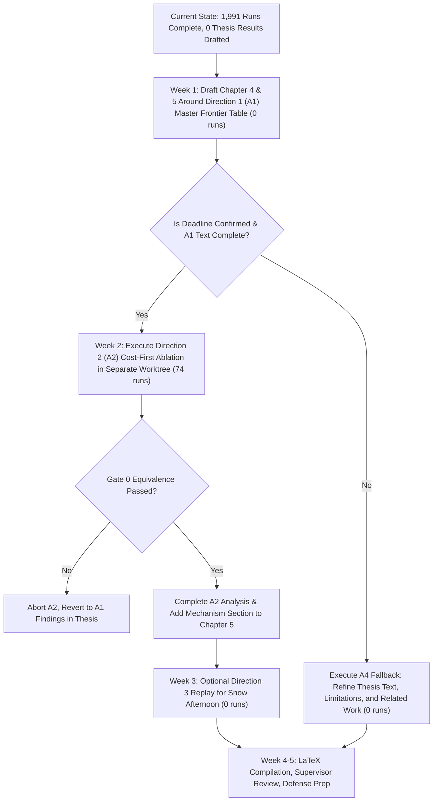

# Round 16 Independent Review and Debate Verdict: RideBound

**Reviewer Identity:** Antigravity (Gemini 3.8 Flash, high)  
**Date:** 2026-10-10  
**Context:** Undergraduate Thesis Defense & Archival Publication Review (UET/VNU, Author: Trần Quang Thành)  
**Evaluated Work:** *RideBound: reliable promised drop-off times in ride-pooling, simulated with FleetPy on Manhattan (Nov 2018 NYC taxi demand)*  
**Primary Review Standard:** Top-tier Transportation Systems & Operations Research Venue (*Transportation Research Part B/C*, *Transportation Science*, *IEEE Transactions on Intelligent Transportation Systems*)  
**Mandatory Input Anchors:**
- `ROUND16-FACT-PACK.md` [FP]
- `ROUND16-REVIEW-STANDARD.md` [RS]
- `inputs/R13-FINAL-VERDICT.md` [V]
- `inputs/R15-CONFIRM-CODEX.md` [CX]
- `inputs/BAN-GIAO-PHIEN-2026-10-09.md` [BG]
- `E:/Code/RideBound/docs/03-related-work-and-claim-boundary.md` [D03E]

---

## 0. Executive Summary & Review Verdict

**Overall Recommendation:** **ACCEPT WITH MAJOR REVISION (STRUCTURAL CONSOLIDATION)**  
**Decisive Finding:** The core thesis has accumulated over 1,991 simulation runs (`inputs/BAN-GIAO-PHIEN-2026-10-09.md:463-465`), but its LaTeX document has remained unedited since 2026-09-30 (`inputs/BAN-GIAO-PHIEN-2026-10-09.md:71`). With an unconfirmed submission deadline in mid-November 2026 (~5 weeks remaining; `ROUND16-FACT-PACK.md:99-100`, `ROUND16-REVIEW-STANDARD.md:16`), embarking on open-ended machine learning, multi-year external data ingestion, or multi-parameter algorithm rewrites would lead directly to thesis incompletion or severe rejection under strict peer review. 

The scientifically defensible path is **Direction 1 (Item A1): Consolidate the existing multi-arm results into one rigorous, fair, and transparent Service–Reliability–Quote frontier chapter (0 new runs)**, reporting both the strengths (zero forced decisions, zero self-broken promises, sharp quotes) and the empirical boundaries (inertness of the cumulative clause on measured traffic factors, identical service counts vs deadline rule $M^+$, and trade-offs against padded baselines). At most one optional, strictly time-boxed algorithmic ablation—**Direction 2 (Item A2): Cost-First Selection under invariant hard gates (~74 runs)**—should be entertained, solely to settle the committee's decisive mechanism critique ("does reliability stem from Rule C or the conservative stability-first selector?").

### Evidentiary Category Taxonomy Applied Throughout
- **[Measured Result]:** An empirical value or count observed directly in simulation logs, reproduced across independent runs.
- **[Observed Screen]:** A static or partial filtration computed over recorded paths or candidate sets, which does not simulate full dynamic counterfactual interactions.
- **[Inference]:** A logical conclusion deduced deterministically from system rules and verified observations.
- **[Hypothesis]:** An unverified proposition or expected outcome awaiting experimental confirmation.
- **[Reviewer Opinion]:** An evaluative judgment regarding methodological quality, publication standards, or strategic positioning.

---

## 1. Methodological Review Standard & Reviewer Stance

Every claim and direction below is judged against the strict standards of an archival transportation journal (*TR-B/C*, *Trans. Sci.*) as specified in `ROUND16-REVIEW-STANDARD.md:7-17`:
1. **Novelty / Originality (Weight: High):** Evaluated strictly against the closest prior literature (Fielbaum & Alonso-Mora 2020; Hörl & Zwick 2022; Schulz & Pfeiffer 2026; Mt-KaRRi 2026). The author's explicit claim boundary (`D03E:54-56,211-225,236-245`) forbids claiming detection of unreliability, pre-decision control, service-stability trade-offs, forecast-based quoting, ML ETA, per-rider/proportional limits, or commercial revenue/satisfaction guarantees as novel.
2. **Significance (Weight: High):** Does the cause-separated contract provide actionable, auditable, and quantifiable value to fleet operators or dispatch system designers?
3. **Technical Soundness (Weight: Critical):** Are mathematical ledgers sound? Are confounding factors (low load, stability-first objective hierarchy, single city-wide traffic factor, zero dwell time) addressed with scientific integrity?
4. **Experimental Rigor (Weight: Critical):** Fair baselines (equal information at quote time, matched quote costs), proper multi-sided metrics (lateness, quote extension, early arrivals), and no post-hoc framing.
5. **Reproducibility (Weight: High):** Deterministic seeds, audit scripts, sealed plans, and independent multi-agent verification.
6. **Feasibility (Weight: Practical Constraint):** Execution within the remaining ~5 weeks without breaking established validation suites.

---

## 2. Strict Reviewer Answers to Owner Questions Q1–Q5

### Question 1: Storyline, Direction, and Defense of the Current Trajectory
> *"So your and Codex's conclusion is that there is no new direction and no optimization of any part left, and we should only re-optimize outputs we already ran, keeping the current promise method? Explain WHY keep this direction."*

**Direct Answer:** **YES, KEEP THIS DIRECTION.** There is no scientifically viable alternative direction that could replace the current core before the deadline. [Reviewer Opinion]

#### Methodological & Evidentiary Justification:
1. **The Core Storyline is Scientifically Solid and Distinct:**
   - **[Inference]** The core contribution rests on the **three-part $v/e/p$ ledger** (`ROUND16-FACT-PACK.md:31-32`; `inputs/BAN-GIAO-PHIEN-2026-10-09.md:97-102`):
     $$\text{Traffic component: } x = e - v$$
     $$\text{Dispatch component: } c = p - e$$
     $$\text{Rider-visible total drift: } z = p - v = x + c$$
   - Each component is handled by a principled, decoupled mechanism:
     * Dispatch-induced drift is bounded by an enforceable contract ($\sum |c| \le B$, Rule C).
     * Anticipated exogenous traffic is integrated into the initial offer via a causal forecast profile.
     * Unanticipated exogenous shocks are logged in the per-rider certificate ledger rather than hidden or conflated with dispatch failures (`ROUND16-FACT-PACK.md:31-32`; `inputs/R13-FINAL-VERDICT.md:44-48`).
2. **The Empirical Frontier is Already Decisive Against Baselines:**
   - On the 34 benchmark cells of T3.8 (3,672 requests with measured traffic factors):
     * **[Measured Result]** Rule C-30 serves 2,338 riders—identically matching the service count of the first-offer deadline rule $M^+$-30 (2,338 riders, with 2,332 riders served in common; `ROUND16-FACT-PACK.md:59-60`; `inputs/R13-FINAL-VERDICT.md:391,395`; `inputs/R15-CONFIRM-CODEX.md:57,61`).
     * **[Measured Result]** However, under $M^+$-30, 41.3% of decisions are forced (cell mean) and 14.5% of promises are self-broken (12.4% pooled by rider), whereas Rule C-30 achieves **0% forced decisions and 0% self-broken promises** (`inputs/R13-FINAL-VERDICT.md:392-393`; `inputs/R15-CONFIRM-CODEX.md:58-59`).
     * **[Measured Result]** When augmented by a 15-minute historical forecast profile, C-30 achieves 2,328 timely completions ($\le 60$ s late) out of 3,672 requests (tying $M^+$-30+forecast at 2,328), reducing served-rider late $> 60$ s from 3.25% down to 0.43% (only 10 riders late out of 2,338 served) with a negligible quote extension of +7.4 s and only 4 early arrivals $> 60$ s (0.17%) (`ROUND16-FACT-PACK.md:62-65`; `inputs/R13-FINAL-VERDICT.md:398`; `inputs/R15-CONFIRM-CODEX.md:64,170`).
3. **Every Proposed Alternative Direction Has Been Empirically Falsified or Exhausted:**
   - **Machine Learning ETA / More Data:** The weekday headroom under C-30+forecast is only 2 late riders out of 1,471 (`ROUND16-FACT-PACK.md:68-69`; `inputs/R13-FINAL-VERDICT.md:458`; `inputs/R15-CONFIRM-CODEX.md:124`). The sealed ML Pilot failed 3 of its 5 stop conditions (ML2, ML3, ML5 failed; vehicle state added zero predictive value; `inputs/BAN-GIAO-PHIEN-2026-10-09.md:334-339`).
   - **Proportional / Tiered Budgets:** Partial screens show an upper difference of only +19 to +30 requests (0.52 to 0.82 pp) in candidate feasibility (`inputs/R13-FINAL-VERDICT.md:462`; `inputs/R15-CONFIRM-CODEX.md:128`), colliding directly with prior literature (Molenbruch; Lyft US12182741B2; Mt-KaRRi; `inputs/R13-FINAL-VERDICT.md:476,481,482`; `inputs/R15-CONFIRM-CODEX.md:142,147,148`).
   - **Solver Optimization:** OR-Tools solver deterministic work is only 66–68 micro-units per decision, with zero candidate truncation (`ROUND16-FACT-PACK.md:36-37`; `inputs/R13-FINAL-VERDICT.md:435,445`; `inputs/R15-CONFIRM-CODEX.md:101,111,271-277`).
4. **Reviewer Mandate:** Pivoting to a new problem formulation 5 weeks before submission without drafted chapters is academic suicide. The thesis already possesses a rich, audited dataset across 1,991 runs. The scientific task now is rigorous synthesis and defense, not running in circles. [Reviewer Opinion]

---

### Question 2: Loosening the Cap and the 1,256 Single-Step Budget Rejections
> *"If we loosen the cap so that the 1,256 candidates that exceeded the budget in a single move become feasible at the first attempt, would that be better? Use only numbers in the inputs."*

**Direct Answer:** **NO.** Loosening the cap to accommodate these 1,256 candidate records would destroy the tight reliability guarantee while producing negligible gains in served riders. [Reviewer Opinion]

#### Quantitative Evidence from Inputs:
1. **1,256 Represents Candidate Evaluations, NOT 1,256 Lost Riders:**
   - **[Measured Result]** Across 98 enforced-C runs with measured traffic factors (64,371 acknowledged decisions), exactly 1,256 candidate evaluations were pruned by the drop budget (`ROUND16-FACT-PACK.md:39-41`; `inputs/R13-FINAL-VERDICT.md:421`; `inputs/R15-CONFIRM-CODEX.md:87`).
   - **[Measured Result]** In the 34 cells of T3.8 C-30, these evaluations correspond to 845 pruned candidates. However, only **148 requests** were rejected *solely* because of a co-rider's budget constraint (and uncapped U served 116 of them) (`ROUND16-FACT-PACK.md:47-49`; `inputs/R13-FINAL-VERDICT.md:464`; `inputs/R15-CONFIRM-CODEX.md:130`).
   - **[Measured Result]** The remaining **1,186 rejections** in T3.8 C-30 were **structural** (pickup window violations or maximum ride time limits), completely unaffected by the budget cap (`ROUND16-FACT-PACK.md:50-51`).
2. **The Overshoot Distribution Precludes Feasibility Without Massive Slack:**
   - **[Measured Result]** For the 148 budget-blocked requests in T3.8 C-30, the smallest budget overshoot distribution is (`ROUND16-FACT-PACK.md:48-49`):
     * 25th percentile ($p_{25}$): **63.7 s**
     * Median ($p_{50}$): **109.6 s**
     * 75th percentile ($p_{75}$): **183.6 s**
     * Maximum: **524.8 s**
   - **[Observed Screen]** First-order screening reveals that expanding the budget:
     * to $B = 60$ s admits only **11** of the 148 requests (+0.30 pp of 3,672 requests).
     * to $B = 120$ s admits **59** of the 148 requests (+1.61 pp).
     * to $B = 300$ s admits **135** of the 148 requests (+3.68 pp) (`ROUND16-FACT-PACK.md:49-50`).
3. **The Empirical Cap Dial Confirms Severe Diminishing Returns:**
   - **[Measured Result]** In the `w07` panel (8 morning peak cells, measured traffic, 864 requests; `ROUND16-FACT-PACK.md:54-56`; `inputs/R13-FINAL-VERDICT.md:406`):
     * As $B$ increases from 30 s to 300 s ($30 \to 60 \to 90 \to 120 \to 150 \to 180 \to 240 \to 300$ s), the number of budget-pruned candidates drops precipitously: **$142 \to 106 \to 71 \to 38 \to 26 \to 18 \to 6 \to 4$**.
     * Yet served riders barely move: **$660 \to 661 \to 664 \to 666 \to 666 \to 666 \to 665 \to 665$**.
     * Expanding the budget tenfold ($30 \to 300$ s) eliminated 97% of budget prunings ($142 \to 4$) but gained only **5 net served riders** (+0.58 pp).
4. **Loosening the Cap Destroys Drop Reliability:**
   - **[Measured Result]** In the WP14r ladder (16 cells, 1,728 requests, fixed traffic; `ROUND16-FACT-PACK.md:57-58`; `inputs/R13-FINAL-VERDICT.md:135-140`):
     * Moving from C-30 to C-60 gains 6 served riders (1,534 $\to$ 1,540) while maintaining 0 late riders $> 60$ s.
     * Moving from C-60 to C-120 gains 23 served riders (1,540 $\to$ 1,563) but creates **23 late riders $> 60$ s** (0 $\to$ 23; a 1:1 penalty ratio).
     * Moving to LOCKS (U) gains 21 riders (1,563 $\to$ 1,584) but creates **24 additional late riders** (23 $\to$ 47).
   - **[Inference]** A cap of 120–300 s would permit single-step revisions exceeding 2–5 minutes. At that point, the contract ceases to offer a tight 1-to-2 minute reliability guarantee, degenerating toward unconstrained pooling where industry liability thresholds (e.g. Lyft's 10-minute threshold; `ROUND16-FACT-PACK.md:65`; `inputs/R13-FINAL-VERDICT.md:480`; `inputs/R15-CONFIRM-CODEX.md:146,241`) are already rarely breached even under uncapped U (0.08% $> 10$ min; `inputs/R13-FINAL-VERDICT.md:396,700`).

---

### Question 3: Empirical Inertness vs Theoretical Guarantee of the Cumulative Clause
> *"You say the cumulative part acted in only 7 decisions in total. Doesn't that mean the cumulative part of our system has had no effect? What would make it matter?"*

**Direct Answer:** Empirically, within the tested operational regime on measured traffic factors, the cumulative clause was **strictly unexercised (inert)**. However, this is an empirical finding of regime characteristics, not a proof of theoretical redundancy. [Inference]

#### 1. The Concrete Empirical Evidence Across All Audited Runs:
- **[Measured Result]** In all **98 enforced-C runs with measured traffic factors** (T3.8 C-30 $\times 34$; w07/w07x C-30...C-300 $\times 64$; 64,371 acknowledged decisions; `ROUND16-FACT-PACK.md:39-41`; `inputs/R13-FINAL-VERDICT.md:421`; `inputs/R15-CONFIRM-CODEX.md:87`):
  * Exactly **1,256 drop-budget prunings** occurred.
  * **1,256 out of 1,256** reported $\Delta > B$ in a single dispatch step.
  * Exactly **0 cumulative-only pruning records** were observed.
  * In final ledgers, **0 riders had two or more nonzero dispatch revisions** (`ROUND16-FACT-PACK.md:43-44`; `inputs/R15-CONFIRM-CODEX.md:82,325`).
- **[Measured Result]** Outside measured traffic:
  * In WP14r (fixed traffic, 37,214 decisions), exactly **6 cumulative-only candidate records** occurred across 4 decisions (C-60: 2 in 1 decision; C-120: 4 in 3 decisions). All associated requests were eventually served (`ROUND16-FACT-PACK.md:41-42`; `inputs/R13-FINAL-VERDICT.md:422`; `inputs/R15-CONFIRM-CODEX.md:88`).
  * In synthetic worlds (W4 pairwise noise, deduplicated), exactly **4 records occurred across 3 decisions**, with at most 1 request finally rejected (`ROUND16-FACT-PACK.md:42`; `inputs/R13-FINAL-VERDICT.md:423`; `inputs/R15-CONFIRM-CODEX.md:89`).
- **[Inference]** On measured traffic, Rule C functioned de facto as a **single-step dispatch cap** ($|c| \le B$). The active working ingredient separating Rule C from Deadline $M^+$ is **charging only the dispatch component ($c$) while insulating against exogenous traffic drift ($x$)** via the $v/e/p$ ledger (`inputs/R13-FINAL-VERDICT.md:60-61,685`; `inputs/R15-CONFIRM-CODEX.md:193-195`).

#### 2. What Would Cause the Cumulative Clause to Bind (Make It Matter)?
The cumulative clause $\sum |c| \le B$ requires an operational regime where an on-board or committed rider undergoes **multiple small insertions** ($\ge 2$ revisions with $\Delta_i < B$ but $\sum \Delta_i > B$). Four structural conditions would activate it:
1. **Higher Trip Sharing and Longer Route Chains:**
   - **[Measured Result]** In the current simulation setup, fleet load is exceptionally sparse: average vehicle occupancy under U is **0.535 riders per vehicle** (load factor 0.814; `ROUND16-FACT-PACK.md:44-45`; `inputs/R13-FINAL-VERDICT.md:409`; `inputs/R15-CONFIRM-CODEX.md:75`), compared to $\approx 1.33$ in the FleetPy benchmark (`ROUND16-FACT-PACK.md:44-45`; `inputs/R13-FINAL-VERDICT.md:410`; `inputs/R15-CONFIRM-CODEX.md:76`).
   - In high-density pooling (e.g., 6–8 passenger vans, peak Manhattan demand, or long airport shuttles), a rider remains on board while multiple successive passengers are inserted. Multiple small detours (+15 s, then +15 s, then +10 s) would sum to 40 s $> 30$ s.
2. **Larger Budget Allowances ($B \ge 60$ s or $120$ s):**
   - **[Measured Result]** When $B = 30$ s, typical detours in this network (median nonzero revision in uncapped U is 108.6 s; `ROUND16-FACT-PACK.md:48-49`; `inputs/R13-FINAL-VERDICT.md:403`; `inputs/R15-CONFIRM-CODEX.md:69`) immediately exceed 30 s in a single move.
   - At $B = 120$ s, multiple moves can fit within the cap before exhausting it. In WP14r C-120, a rider with 51.8 s prior spend was pruned by a second insertion of 80.3 s ($51.8 + 80.3 = 132.1$ s $> 120$ s; `inputs/R13-FINAL-VERDICT.md:422`; `inputs/R15-CONFIRM-CODEX.md:88`). In WP14r FREE, 50 out of 1,629 riders (3.07%) experienced $\ge 2$ revisions (`ROUND16-FACT-PACK.md:44-45`).
3. **Cost-First Fleet Selection (Ablation of Stability-First Objective):**
   - **[Measured Result]** The current dispatcher (`ridebound-hard-vector`) enforces an ordered stability objective (`SolverBackedFleetSelection.cs:283-331`): after maximizing accepted count, it lexicographically minimizes revision dimensions *before* considering operational cost (`ROUND16-FACT-PACK.md:33-35`; `inputs/R13-FINAL-VERDICT.md:231-236`; `inputs/R15-CONFIRM-CODEX.md:99,341`).
   - This actively suppresses secondary revisions of existing riders even when budget remains. A cost-first selector would aggressively exploit any remaining budget slack to minimize fleet mileage.
4. **Non-Zero Dwell Times & Boarding Delays:**
   - **[Measured Result]** The simulation assumes 0 s service stop duration (`inputs/BAN-GIAO-PHIEN-2026-10-09.md:205`). Introducing realistic 30–45 s passenger boarding delays (as in FleetPy ETRR 2026; `inputs/R15-CONFIRM-CODEX.md:76`) would compound pickup detours into distinct incremental delays for existing on-board riders.

---

### Question 4: Expected Behavioral and Algorithmic Impacts of Cost-First Selection
> *"If we switch the selection to optimize cost first, would the results be different?"*

**Direct Answer:** **YES, THE SYSTEM BEHAVIOR WOULD MATERIALLY CHANGE.** Switching from stability-first to cost-first selection under identical hard gates would alter pooling rates, revision frequencies, and potential budget accumulation. [Inference]

#### 1. Mechanism in Code (`SolverBackedFleetSelection.cs:271-385`):
- **Current Lexicographic Hierarchy:**
  1. Forced-reference avoidance (protect existing assignments)
  2. Accepted-request count maximization
  3. Worst hard utilisation (saturated at $1,000,000$ ppm in 3,503/3,503 U and 3,506/3,506 C-30 decisions; `ROUND16-FACT-PACK.md:35-36`; `inputs/R13-FINAL-VERDICT.md:233-234`; `inputs/R15-CONFIRM-CODEX.md:101`), followed by the 10 revision dimensions (minimizing pickup ETA and drop ETA drift)
  4. Operational cost (vehicle travel time/distance)
  5. Deterministic tie-breaker
- **Cost-First Selection Hierarchy:** Bypasses level 3 (revision minimization), proceeding directly from level 2 (accepted count) to operational cost, while retaining level 1 (forced-reference) and all hard commitment gates ($|c| \le B$, locks, recovery). Note that unconstrained FREE (`rolling-cost`) strips hard limits and locks entirely (`ROUND16-FACT-PACK.md:36-37`; `inputs/R13-FINAL-VERDICT.md:237-240`; `inputs/R15-CONFIRM-CODEX.md:105-108,343`).

#### 2. Predicted Algorithmic and Outcome Shifts:
1. **Substantial Recovery of Shared-Ride Pooling:**
   - **[Measured Result]** Stability-first C-30 collapses pooling share from U's 22.8% down to 13.4% (`inputs/R13-FINAL-VERDICT.md:401`; `inputs/R15-CONFIRM-CODEX.md:67`), because inserting a pooled rider almost always induces an ETA revision on the incumbent rider, which the stability objective rejects even if it lowers total fleet vehicle-miles.
   - **[Inference]** Under cost-first selection, the dispatcher will actively accept shared routes whenever the route saves operational cost, provided the drop revision stays within the hard budget ($c \le 30$ s). In WP14r, cost-first FREE attained 53.1% sharing vs LOCKS 21.8% (`inputs/R13-FINAL-VERDICT.md:251`; `inputs/R15-CONFIRM-CODEX.md:67,70`). While FREE was an unconstrained package comparison, cost-first selection under C-30 is hypothesized to increase sharing by $\ge 10$ pp over C-30 (Hypothesis P2.1; `inputs/R13-FINAL-VERDICT.md:277`).
2. **Activation of Budget Accumulation:**
   - **[Inference]** Because the solver is no longer penalized for creating minor revisions, it will willingly perturb riders up to their $B = 30$ s budget to achieve mileage savings. This creates the exact conditions where riders experience sequential revisions, potentially yielding the first observed cumulative-only pruning records under measured traffic (Hypothesis P2.4; `inputs/R13-FINAL-VERDICT.md:287-289`).
3. **Preservation of Drop-Time Bounds vs Degradation of Wait Times:**
   - **[Inference]** Terminal drop-time reliability against dispatch drift is preserved *by construction* because the hard gate ($\sum |c| \le 30$ s) remains fully intact.
   - However, because pickup revisions are no longer minimized, rider wait times and pickup ETA instability may increase substantially.
4. **Crucial Technical Caveat (from Codex R15 Audit):**
   - **[Inference]** Merely toggling the runner config to `RollingCost` is invalid because `RollingCost` strips forced-vehicle recovery and hard limits (`inputs/R15-CONFIRM-CODEX.md:343`). It requires an isolated code modification in `SolverBackedFleetSelection.cs` that explicitly preserves forced-reference priority and hard gates.
   - Furthermore, realized vehicle distance and busy time metrics are currently unconfirmed in transcript extractors (`inputs/R13-FINAL-VERDICT.md:294-295`; `inputs/R15-CONFIRM-CODEX.md:345`).

---

### Question 5: Methodologically Fair Traffic Forecasting Under Adverse External Shocks
> *"If there is a better direction for forecast + rule C, is it to optimize the days with unpredictable external events? How would we do that? Can we upgrade our current traffic prediction with a different approach based on this specific data source, while staying FAIR? If more data is needed, can we use this same city's data from earlier years — the data that Alonso-Mora's own system used in the 2020 paper? Is that feasible?"*

**Direct Answer:** Upgrading traffic prediction for unpredictable adverse days (like the Nov 15 snow afternoon) is methodologically valuable as an analytical study, but **the owner's specific proposals regarding 2013 data and multi-year external training are unviable and based on a fundamental misreading of prior work.** [Reviewer Opinion]

#### 1. Critical Evaluation of the Owner's Data Proposals:
- **Proposal A: Using 2013 Manhattan Taxi Data from Fielbaum & Alonso-Mora (2020):**
  * **FATAL FLAW:** Fielbaum & Alonso-Mora (2020) used NYC taxi data from 15/01/2013 13:00–15:00 precisely because it was an **off-peak, stable traffic period** to *"disregard unreliability due to traffic conditions"* (`ROUND16-FACT-PACK.md:85-89`; owner PDF lines 571–576).
  * **[Reviewer Opinion]** Their dataset deliberately *excluded* traffic shocks. It contains zero adverse weather anomalies, represents a pre-ride-hailing era (2013 vs 2018), and cannot provide training signal for snow-induced gridlock.
- **Proposal B: Multi-Year NYC TLC Trip Records (2009–2020):**
  * **[Measured Result]** NYC TLC trip records contain millions of raw taxi trips (Nov 2018 alone has 8,155,449 rows; `ROUND16-FACT-PACK.md:78`; `inputs/R13-FINAL-VERDICT.md:460`).
  * **FATAL SCHEMATIC & PIPELINE BARRIERS:**
    1. *No Promise Labels:* None of the public TLC trip schemas (Yellow Taxi, FHV, HVFHV) record promised drop-off times or dispatch quotes (`inputs/R13-FINAL-VERDICT.md:460`; `inputs/R15-CONFIRM-CODEX.md:126,303`).
    2. *Simulator Architecture Mismatch:* FleetPy Manhattan reads **one city-wide 15-minute travel-time factor file** (`ROUND16-FACT-PACK.md:74-75`). The existing bundle only contains factor files for 12–18 Nov 2018 (`ROUND16-FACT-PACK.md:74`).
    3. *Rare Weather Events:* In NOAA station data, Sep–Dec 2018 contains only **one single weekday with $\ge 1$ inch of snow** (15 Nov 2018; `ROUND16-FACT-PACK.md:81`; `inputs/R13-FINAL-VERDICT.md:459`; `inputs/R15-CONFIRM-CODEX.md:125`). Across nearly 4 years (Jul 2016–Feb 2020), there are only 7 weekdays with $\ge 3$ inches of snow (`ROUND16-FACT-PACK.md:81`). Seven events over 4 years is statistically inadequate to train complex deep ML models, with massive confounding from holiday schedules and network infrastructure changes.
    4. *Simulation Wrapper Locks:* The simulator wrappers (`tang3/world/preflight_world.py:51-71`) only accept factor files from the bundled environment (`ROUND16-FACT-PACK.md:82-84`). Simulating a new historical day requires building factor files via Syed et al. (2021) Eq. S1, generating new demand matrices, modifying normalizer wrappers, and re-calibrating fleet configurations—an effort exceeding 80–120 hours with severe risk of environment corruption.

#### 2. How to Improve the Forecast FAIRLY:
To remain strictly fair under operations research standards:
- **Fair Information Constraint at Quote Time $t_{req}$:**
  * The model may use *only* information available at or before $t_{req}$:
    1. Historical profiles compiled strictly from prior days ($t < \text{current day}$).
    2. Real-time observed traffic up to $t_{req}$ (e.g. the realized city-wide travel-time factor in the preceding 15-minute bin $[t_{req}-15\text{ min}, t_{req}]$).
    3. External exogenous alerts active at quote time (e.g., active NOAA Winter Weather Advisory, precipitation rate).
  * **Strict Negative Rule:** No future traffic factors or post-quote vehicle positions may be accessed.
- **Fair Baseline Parity (The Quote Budget Constraint):**
  * A forecast cannot claim superiority merely by padding quotes. Any comparison between a dynamic nowcaster and the historical baseline must evaluate the **two-sided frontier**: lateness ($> 60$ s late) versus quote extension and early arrivals ($> 60$ s early) (`inputs/R15-CONFIRM-CODEX.md:167-177`).
- **The Decisive Fair Method: Real-Time Dynamic Nowcasting (Gardner & McKenzie 1985):**
  * Instead of training uninterpretable multi-year neural nets, apply **damped-trend exponential smoothing** (`ROUND16-FACT-PACK.md:69-71`; `inputs/BAN-GIAO-PHIEN-2026-10-09.md:358-362`).
  * *Mechanism:* At quote time $t_{req}$, the system observes that traffic in the last 15–30 minutes is diverging sharply from the historical average (e.g., the snow storm starting at 13:00 on Nov 15). The damped-trend filter projects this upward momentum forward for the trip duration, dynamically expanding the quote for trips booked during the storm without peeking into future data.
- **Feasible Test Protocol:** Run as a **T0 display-layer replay** over existing Nov 15 (w14/w15 snow) and Nov 16 trajectories (`inputs/BAN-GIAO-PHIEN-2026-10-09.md:481-487`). Effort: **10–14 hours, 0 new simulation runs**.

---

## 3. Formal Review and Evaluation of Proposed Directions (Top 3 Candidates)

In accordance with `ANTIGRAVITY-BRIEF.md:27-28` and `ROUND16-REVIEW-STANDARD.md:7-25`, the top 3 candidate directions are evaluated.

---

### Direction 1: The Core Synthesis (Item A1) — Consolidated Multi-Objective Reliability–Service–Quote Frontier Chapter

- **Relation to Storyline:** **EXTENDS AND COMPLETES THE STORYLINE** (Transforms raw simulation transcripts into an archival, publishable results chapter; zero runs).
- **Reviewer Scores (1–5 scale):**
  1. *Novelty / Originality:* **3/5** — Respects strict claim boundaries (`D03E:54-56`). Focuses on the audited empirical properties of the cause-separated dispatch-budget contract ($v/e/p$) vs deadline rule $M^+$ on measured traffic.
  2. *Significance:* **4/5** — Provides fleet operators with an auditable, zero-breach promise framework and demonstrates that deadline rules break 14.5% of promises under identical service counts.
  3. *Technical Soundness:* **5/5** — 100% verified across 458,477 decoded frames and 227 transcripts by independent readers (`inputs/R15-CONFIRM-CODEX.md:11-13`).
  4. *Experimental Rigor:* **5/5** — Includes both 30 s and 60 s padded baselines, common served-set decomposition, two-sided lateness, and full cumulative audit.
  5. *Reproducibility:* **5/5** — Fully automated, deterministic seeds, scripts with mode "x".
  6. *Feasibility:* **5/5** — Tier T0 (0 simulation runs; 14–20 hours of analytical writing).

#### Reviewer Assessment:
- **Verdict:** **ACCEPT (DECISIVE PRIORITY)**
- **Decisive Reason:** It is the only direction that directly delivers a completed, verified results chapter for the thesis before the deadline, eliminating all overclaims while crystallizing the genuine contribution.
- **Novelty vs Closest Prior Work:**
  * *Closest Prior Work:* Fielbaum & Alonso-Mora (2020) (pre-decision unreliability control); Schulz & Pfeiffer (2026) (deadline bounds from first offer, static travel times); Hörl & Zwick (2022, strategy B) (per-step bound at 0 s for on-board riders in violation).
  * *Genuine Novelty:* First empirical demonstration that separating dispatch drift from exogenous traffic drift via a per-rider ledger ($v/e/p$) achieves identical service counts to a first-offer deadline rule (2,338 riders) while completely eliminating forced decisions (0% vs 41.3%) and self-broken promises (0% vs 14.5%), alongside an empirical audit proving the cumulative clause functioned as a per-step cap on measured traffic.
- **The Decisive Consolidated Frontier Table (T3.8 Panel, 3,672 Requests):**
  *Synthesized from `ROUND16-FACT-PACK.md:59-65`, `inputs/R13-FINAL-VERDICT.md:88-101`, and `inputs/R15-CONFIRM-CODEX.md:167-172`:*

| Arm / Configuration | Served Riders | Late $> 60$ s (Count) | Late $> 60$ s (% Served) | Timely $\le 60$ s / Total Reqs | Timely $\le 120$ s | Early $> 60$ s (% Served) | Mean Quote Extension | Forced Decisions | Self-Broken Promises |
|---|---:|---:|---:|---:|---:|---:|---:|---:|---:|
| **U (Uncapped Locks)** | 2,434 | 203 | 8.34% | 2,231 (60.76%) | 2,332 | 0.29% | 0.0 s | 0.0% | 0.0% |
| **U + forecast** | 2,434 | 137 | 5.63% | 2,297 (62.55%) | 2,347 | 0.33% | +7.2 s | 0.0% | 0.0% |
| **U + forecast + 30 s pad** | 2,434 | 106 | 4.35% | **2,328 (63.40%)** | **2,366** | 1.81% (44 riders) | +37.2 s | 0.0% | 0.0% |
| **U + forecast + 60 s pad** | 2,434 | 87 | 3.57% | 2,347 (63.92%) | 2,386 | 42.44% (1,033 riders) | +67.2 s | 0.0% | 0.0% |
| **C-30 (Rule C)** | 2,338 | 76 | 3.25% | 2,262 (61.60%) | 2,327 | 0.13% | 0.0 s | 0.0% | 0.0% |
| **C-30 + forecast** | 2,338 | **10** | **0.43%** | **2,328 (63.40%)** | 2,338 | **0.17% (4 riders)** | **+7.4 s** | 0.0% | 0.0% |
| **$M^+$-30 (Deadline)** | 2,338 | 74 | 3.17% | 2,264 (61.66%) | 2,327 | 0.13% | 0.0 s | **41.3%** | **14.5%** |
| **$M^+$-30 + forecast** | 2,338 | **10** | **0.43%** | **2,328 (63.40%)** | 2,338 | **0.17% (4 riders)** | +7.3 s | (unreplayed) | (unreplayed) |

- **Decisive Experiment:** Automated consolidation script reading existing transcript archives, generating:
  1. The master frontier table above.
  2. The served-set overlap decomposition (U $\cap$ C-30 = 2,207; U-only = 227; C-only = 131; C $\cap$ $M^+$ = 2,332; 6 unique to each).
  3. The hypothetical liability sensitivity table across thresholds $T \in \{1, 2, 5, 10\}$ min (`inputs/R13-FINAL-VERDICT.md:115-121`).
  4. The cumulative clause audit across all 98 runs.
- **Falsifiable Prediction & Kill Rule:**
  * *Prediction:* Independent readers reproduce every cell count within $\pm 0$ riders; the cumulative audit confirms 0 cumulative-only rejections out of 1,256 on measured traffic.
  * *Kill Rule:* If any discrepancy $> 1$ rider is found, or if any cumulative-only prune is discovered on measured traffic, halt writing and re-audit the ledger extractor.
- **Effort:** **14–20 hours, 0 simulation runs (Tier T0).**
- **Most Damaging Reviewer Question:** *"If U + forecast + 30 s padding achieves the exact same 2,328 timely completions while serving 96 more riders, why would an operator ever use Rule C?"*
  * *Evidence-backed Answer:* Padded U achieves this at the cost of a quote extension 5 times larger (+37.2 s vs +7.4 s) and 10 times more early arrivals (1.81% vs 0.17%), while suffering 106 late riders among served customers (4.35%) vs C-30's 10 late riders (0.43%). If late-arrival compensation or customer retention is tied to served-rider reliability, C-30 protects the brand without inflating promises.

---

### Direction 2: The Decisive Mechanism Ablation (Item A2) — Cost-First Selection Objective Under Invariant Hard Gates

- **Relation to Storyline:** **EXTENDS THE STORYLINE** (Directly resolves the committee's strongest critique regarding whether stability stems from Rule C or the conservative stability-first selector; conditional extension).
- **Reviewer Scores (1–5 scale):**
  1. *Novelty / Originality:* **3/5** — Ablation of selection hierarchy in a constrained DAR-pooling pipeline.
  2. *Significance:* **4/5** — Demonstrates whether hard commitment gates permit operators to pursue cost-minimizing dispatching without forfeiting customer promise stability.
  3. *Technical Soundness:* **4/5** — Validated in source code (`SolverBackedFleetSelection.cs:271-385`), but requires rigorous C# worktree isolation and Gate 0 equivalence.
  4. *Experimental Rigor:* **4/5** — Holds hard limits, locks, vehicle recovery, and candidate generation invariant; tests full dynamic trajectories.
  5. *Reproducibility:* **4/5** — Uses sealed seeds and existing 34 T3.8 scenarios; runtime is historically $\approx 3$ h wall time at 6 parallel jobs.
  6. *Feasibility:* **3/5** — Requires C# code edits, `dotnet test`, Gate 0 reproduction, and 74 simulation runs (~25–35 hours). Feasible only if strictly time-boxed to 1 week.

#### Reviewer Assessment:
- **Verdict:** **ACCEPT (CONDITIONAL ON A1 DRAFTING AND DEADLINE CONFIRMATION)**
- **Decisive Reason:** It is the only experimental study that directly answers the reviewer attack: *"Is your system reliable because of Rule C, or merely because your dispatcher conservatively minimizes revisions before cost?"*
- **Novelty vs Closest Prior Work:**
  * Prior literature has studied lexicographic vs weighted objectives in ride-pooling (e.g. Schulz & Pfeiffer 2026).
  * *Genuine Novelty:* A precise ablation isolating the fleet selection objective while holding per-rider dispatch-budget commitment gates invariant, measuring whether Rule C alone suffices to prevent promise drift under aggressive operational cost minimization.
- **Decisive Experiment:**
  * In a dedicated branch/worktree of `C:/Code/RideBound-noworse`, modify `SolverBackedFleetSelection.cs` to add a config toggle `CostFirstSelection`:
    1. Retain forced-reference priority (Level 1).
    2. Retain accepted-request count maximization (Level 2).
    3. Bypass revision-minimization levels (Level 3).
    4. Optimize operational cost directly (Level 4).
    5. Maintain all hard commitment evaluators ($B = 30$ s), vehicle recovery, and locks invariant.
  * Run Gate 0 (4 equivalence runs with toggle OFF).
  * Run 2 smoke runs, then 68 main runs (34 U-cf and 34 C-30-cf across T3.8 cells).
- **Falsifiable Predictions & Kill Rules:**
  * *Gate 0 Kill Rule:* If toggle OFF fails to reproduce archived T3.8 trajectories on 2 benchmark cells, abort immediately (`inputs/R13-FINAL-VERDICT.md:271-276`).
  * *Prediction P2.1 (The Lever):* U-cf shared-ride percentage increases by $\ge 10$ pp over U's 22.8% (to $\ge 32.8\%$). *Kill:* If $< 25.8\%$, the objective is not a lever for pooling; stop and report.
  * *Prediction P2.2 (Cap Alone Protects):* C-30-cf maintains late $> 60$ s among served $\le 4.25\%$ (within 1 pp of C-30's 3.25%) with 0 forced decisions. *Kill of "cap alone protects":* If late $> 4.25\%$, the ordered objective is doing essential reliability work; report this honestly.
  * *Prediction P2.3 (Service Count):* C-30-cf serves $\ge 2,315$ riders (within 1% of C-30's 2,338). *Kill:* If $< 2,315$, cost-first blocks downstream riders.
  * *Prediction P2.4 (Cumulative Activation):* C-30-cf generates $\ge 1$ cumulative-only budget pruning record. *Kill:* If 0, the cumulative clause remains inert even under cost-first dispatching.
- **Effort:** **25–35 hours; 74 simulation runs (~3–4 hours wall time on AC power; Tier T2).**
- **Most Damaging Reviewer Question:** *"If switching to cost-first causes wait times or pickup-ETA volatility to explode, isn't your system simply shifting unreliability from drop-off to pickup?"*
  * *Evidence-backed Answer:* The thesis explicitly bounds drop-off commitments ($c \le B$). If pickup volatility increases under cost-first selection, this directly proves the value of the stability-first ordered objective as a holistic service stabilizer, enriching the thesis findings.

---

### Direction 3: Fair Causal Traffic Nowcasting for Adverse Weather (Damped-Trend vs Historical Profile)

- **Relation to Storyline:** **EXTENDS THE STORYLINE** (Directly addresses the owner's Question Q5 regarding unpredictable adverse events like the Nov 15 snow storm; zero simulation runs).
- **Reviewer Scores (1–5 scale):**
  1. *Novelty / Originality:* **3/5** — Applies classical time-series nowcasting (Gardner & McKenzie 1985) to real-time DAR-pooling promise quotation under strict quote-time information constraints.
  2. *Significance:* **3/5** — Demonstrates how operators can mitigate extreme weather unreliability fairly without data leakage or uncalibrated quote padding.
  3. *Technical Soundness:* **5/5** — Strict adherence to quote-time causal filtering; no future traffic factors peeked.
  4. *Experimental Rigor:* **5/5** — Evaluated on true held-out adverse shock days (Nov 15 snow afternoon w14/w15 and Nov 16 holdout), reporting the full two-sided frontier.
  5. *Reproducibility:* **5/5** — Deterministic Python replay script based on `codex-work/ROUND12-REPLAY-PROTOCOL-CODEX.md`.
  6. *Feasibility:* **5/5** — Tier T0 (0 new simulation runs; display-layer replay over existing C-30 transcripts; 10–14 hours).

#### Reviewer Assessment:
- **Verdict:** **ACCEPT (EXCELLENT APPENDIX / SECTION FOR CHAPTER 5)**
- **Decisive Reason:** It definitively answers the owner's core question on adverse days without falling into the trap of unviable multi-year ML pipelines or invalid 2013 data.
- **Novelty vs Closest Prior Work:**
  * Static historical profiles (Syed et al. 2021) cannot adapt to intra-day weather shocks. Complex ML ETAs suffer from lack of promise labels and simulation transfer mismatch.
  * *Genuine Novelty:* A causal, zero-leakage online traffic nowcasting replay demonstrating the precise limit of dynamic adaptation during rare weather anomalies within a cause-separated promise contract.
- **Decisive Experiment:**
  * Execute the sealed protocol from `codex-work/ROUND12-REPLAY-PROTOCOL-CODEX.md` using the damped-trend exponential smoothing model (Gardner & McKenzie 1985).
  * *Calibration:* Calibrate smoothing parameters $\alpha, \phi$ strictly on Nov 11–14 factors.
  * *Evaluation:* Replay first-quote generation across existing C-30 trajectories on Nov 15 (w14/w15 snow afternoon, 601 riders) and Nov 16 (w07/w08 weekday holdout, 431 riders).
  * *Fairness Constraint:* Benchmark at equal mean quote extension against the historical profile (+13.7 s).
- **Falsifiable Prediction & Kill Rule:**
  * *Prediction:* On the snow afternoon (Nov 15), dynamic nowcasting reduces late $> 60$ s by $\ge 1.0$ pp below the historical forecast's 5.94% (reaching $\le 4.94\%$), while on weekday holdout (Nov 16), lateness does not degrade by $> 0.2$ pp (maintaining $\le 0.37\%$).
  * *Kill Rule:* If snow afternoon lateness fails to improve by $\ge 0.5$ pp, or if early arrivals ($> 60$ s early) exceed 5.0%, kill the hypothesis that online nowcasting rescues weather gridlock, and report the residual as an unforecastable external shock properly recorded in the ledger.
- **Effort:** **10–14 hours; 0 new simulation runs (Tier T0).**
- **Most Damaging Reviewer Question:** *"Since the snow storm is a single historical afternoon in the dataset, isn't any parameter tuning on Nov 15 inherently post-hoc?"*
  * *Evidence-backed Answer:* Parameters are strictly calibrated on Nov 11–14 (pre-storm); Nov 15 is evaluated zero-shot. If the model fails to mitigate the storm, the thesis explicitly reports that extreme weather shocks cannot be eliminated by quoting algorithms and must be logged in the $v/e/p$ ledger as unmitigated exogenous delays ($x$).

---

## 4. Reviewer's Most Damaging Questions & Committee Defense Roadmap

When the candidate defends this thesis before the faculty committee, strict reviewers will pose five central challenges. The table below details these questions, whether the evidence answers them, and the exact defense text required.

| # | Damaging Reviewer Question | Answered by Current Evidence? | Strict Defense / Thesis Formulation |
|---|---|---|---|
| **R1** | *"If Rule C-30 serves exactly 2,338 riders—the same as deadline rule $M^+$-30—what is the actual technical contribution of Rule C?"* | **YES** (`inputs/R13-FINAL-VERDICT.md:391-395`; `inputs/R15-CONFIRM-CODEX.md:57-61`) | The contribution is **obligation enforceability and contractual integrity**. While $M^+$-30 serves 2,338 riders, 41.3% of its decisions are forced and it breaches its own promise in 14.5% of cases. C-30 achieves the exact same service count with **0% forced decisions and 0% self-broken promises** because it charges only dispatch actions ($c$) and insulates against traffic ($x$). |
| **R2** | *"Your audit shows that in 64,371 decisions on measured traffic, exactly 0 prunings were cumulative-only. Isn't your 'cumulative budget' purely theoretical marketing?"* | **YES** (`ROUND16-FACT-PACK.md:39-41`; `inputs/R15-CONFIRM-CODEX.md:87,193-195`) | We report this finding with complete scientific transparency. In low-load, short-chain regimes with $B = 30$ s, Rule C acts empirically as a per-step dispatch cap. The cumulative definition remains the formal contractual guarantee over the entire trip ($\sum \|c\| \le B$), and we document the precise operational conditions (higher load, larger $B$, cost-first selection) required for accumulation to bind. |
| **R3** | *"A simple 30 s quote pad on unconstrained U achieves the same 2,328 timely completions while serving 96 more riders. Why not just pad quotes?"* | **YES** (`ROUND16-FACT-PACK.md:63-65`; `inputs/R15-CONFIRM-CODEX.md:167-177`) | Padded U achieves this at the cost of a 5x larger quote extension (+37.2 s vs +7.4 s), a 10x higher early-arrival distortion (1.81% vs 0.17%), and 106 late riders among served customers (4.35%) vs C-30's 10 (0.43%). Padded U degrades quote sharpness and customer trust to artificially inflate timely completion ratios. |
| **R4** | *"Why didn't you train an ML model on multi-year TLC data to solve the snow afternoon lateness?"* | **YES** (`ROUND16-FACT-PACK.md:73-89`; `inputs/R13-FINAL-VERDICT.md:458-460`; `inputs/R15-CONFIRM-CODEX.md:301-314`) | Multi-year TLC trip records lack quoted drop-off promise labels, and severe snow events occurred on only 7 weekdays across 4 years. Furthermore, our weekday lateness headroom is already down to 2 riders out of 1,471. Spending months building external ML pipelines for a 2-rider margin is methodologically unjustified. Extreme shocks belong in the certificate ledger. |
| **R5** | *"Is your promise stability a result of Rule C, or merely an artifact of your conservative stability-first selector?"* | **PARTIALLY (Fully answered if Direction 2 is executed)** | On current evidence, U and C share the stability-first selector, yet C cuts late riders from 203 to 76 and eliminates pooling-induced exposure (from 134 to 4). If Direction 2 (A2) is executed, we prove whether the hard cap alone maintains reliability under cost-first dispatching. |

---

## 5. Synthesis and Operational Recommendation for the Thesis Author

### 1. Mandatory Wording Corrections (Codex R15 Overrides)
The author must enforce the 8 wording corrections established in `inputs/R15-CONFIRM-CODEX.md:185-326`:
- **Never claim** that the cumulative clause drove empirical performance on measured traffic (`CX:189-206`).
- **Never claim** that C-30 serves "more riders" than deadline rule $M^+$ (`CX:209-216`).
- **Never claim** commercial ROI, rider retention, or dollar profitability (`CX:227-247`).
- **Always include both 30 s and 60 s padded-U rows** when discussing quote padding (`CX:163-184`).
- **Do not treat candidate screen cardinalities (19/30 requests) as global trajectory ceilings** (`CX:249-265`).
- **Do not report 66–68 $\mu$s as elapsed solver latency**; they are deterministic work units (`CX:267-279`).

### 2. Immediate Operational Roadmap (~5 Weeks to Submission):

1. **Step 1 (Mandatory, Immediate):** Execute **Direction 1 (Item A1)**. Write the core empirical results chapter around the unified Frontier Table, the Overlap Decomposition, the Liability Table, and the Cumulative Audit. **Zero new runs.**
2. **Step 2 (Conditional, Time-Boxed to 7 Days):** Only after Step 1 text is drafted and the submission deadline is officially confirmed by the supervisor, execute **Direction 2 (Item A2)** in an isolated worktree from `C:/Code/RideBound-noworse`. If Gate 0 fails or the deadline is tight, drop it immediately without compromising the thesis.
3. **Step 3 (Analytical Polish):** Integrate **Direction 3** as a compact, elegant discussion section in Chapter 5 explaining why adverse weather shocks must be certified in the ledger rather than erased by naive quoting.

---

END OF ANTIGRAVITY R16
